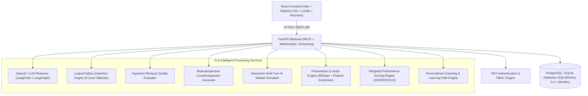

# JustiTalk: Architecture & Implementation Blueprint

**Platform:** Agentic AI Debate Coach & Presentation Analysis Platform  
**Branding:** JustiTalk  
**Design Reference:** Faithful recreation of JustiTalk Dashboard UI (warm cream background `#F9F7F2`, golden yellow accent `#D4A017` / `#DF9E16`, white rounded cards, charcoal text `#1E242B`)

---

## 1. System Architecture

---

## 2. Implementation Stages

| Stage | Milestones & Deliverables | Status |
|---|---|:---:|
| **Stage 1** | **Project Foundation & Core Setup**: FastAPI project structure, SQLAlchemy models & DB migrations, JWT auth with RBAC (Learner, Coach, Educator, Admin), seed data, full React setup with Tailwind & exact JustiTalk UI styling, responsive Sidebar, Topbar, 6 Stat Cards, Quick Actions, Recharts charts, and Profile management. | 🚀 In Progress |
| **Stage 2** | **Argument Intelligence**: Argument Analysis Engine (claim, evidence, strength, clarity), Logical Fallacy Detector (Ad Hominem, Straw Man, False Dilemma, Slippery Slope, Appeal to Authority, Circular Reasoning, Hasty Generalization, Red Herring), and 5-dimensional Counterargument Generator. | 📋 Planned |
| **Stage 3** | **Agentic AI Debate Coach**: Interactive AI debate simulation, difficulty settings, dynamic AI arguments, round tracking, timer, weighted scoring formula engine, and personalized coaching recommendations. | 📋 Planned |
| **Stage 4** | **Presentation Analytics**: Audio upload and processing, Whisper speech transcription, WPM pacing, filler word detection, pause analysis, confidence and clarity metrics, and presentation assessment reports. | 📋 Planned |
| **Stage 5** | **Role Dashboards, Reports & DevOps**: Learner, Coach, Educator, and Admin dashboards; Notifications system; PDF & Excel export; Docker & Docker Compose setup; End-to-end testing and validation. | 📋 Planned |
