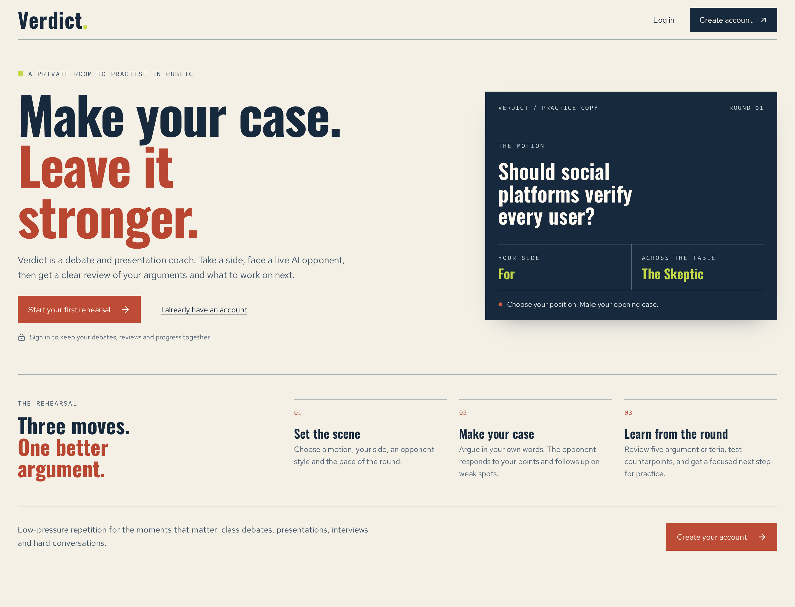
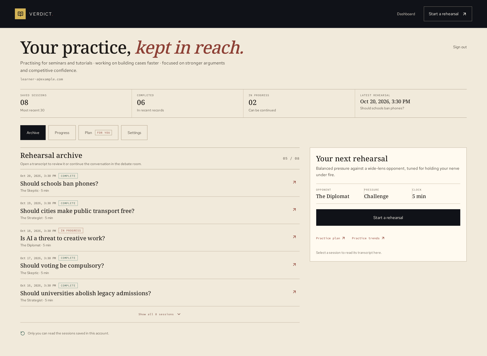
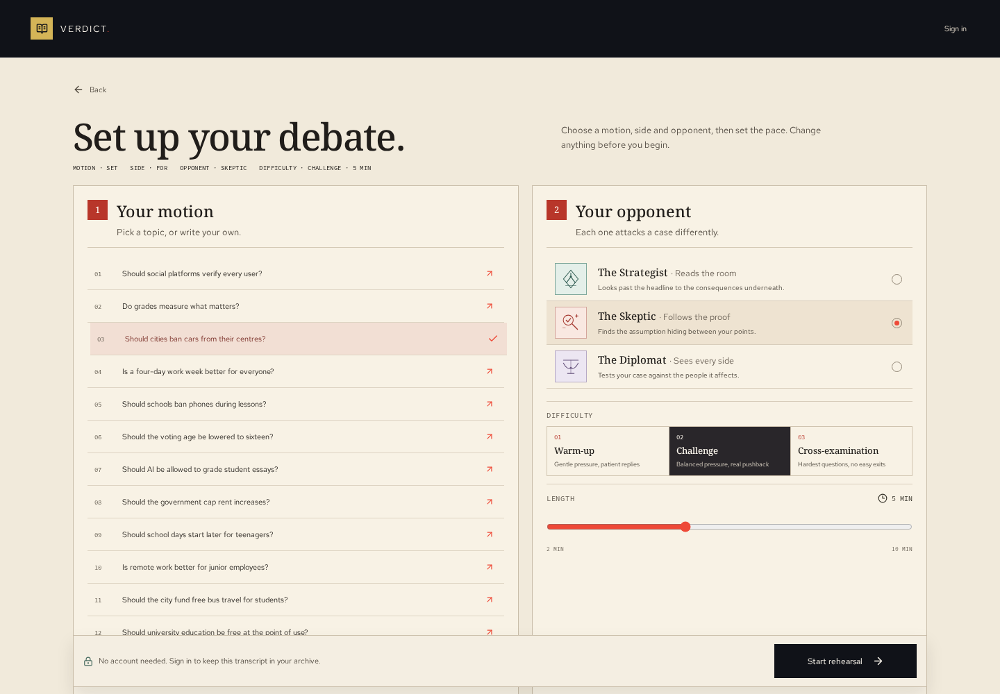
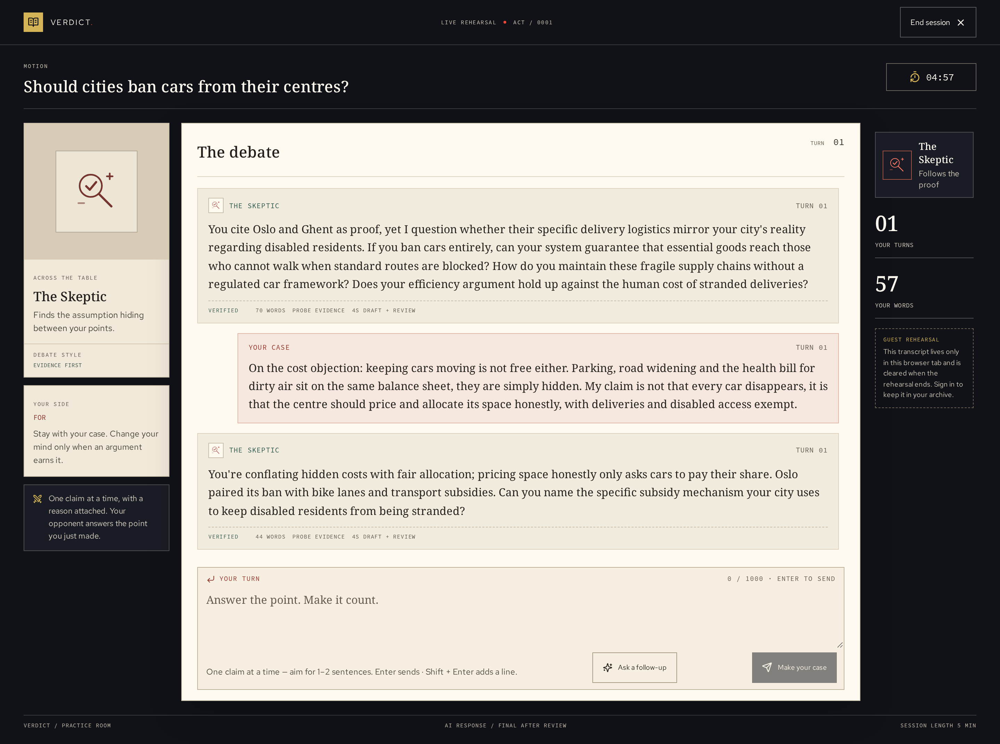
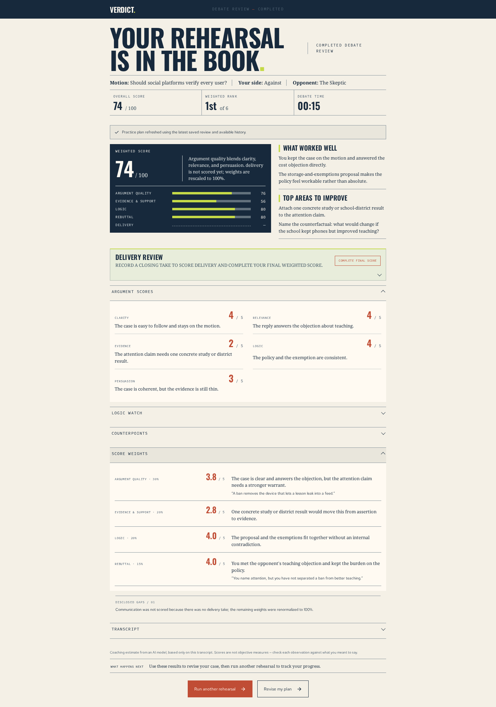

# Verdict

**Debate practice, with a point of view.**

Verdict is an AI debate coach for students and self-directed learners. Choose a motion, take a side, and argue it live against an opponent with a distinct personality — then get coaching on both what you argued and how you sounded saying it.

Visitors can explore the public overview. A Supabase account is required to enter Debate, Analysis, the practice plan, and saved work.

> **Status:** a complete local product with real AI orchestration, not a deployed service. It runs on your machine against Ollama, or against any OpenAI-compatible endpoint you configure. There is no public demo URL. Roughly half the modules in the original course spec are done, several are partial, and some are absent; the [spec coverage](#spec-coverage) table below says which is which instead of claiming the whole brief.



---

## What you can do

**Rehearse a live debate.** Choose a motion from your topic bank or write your own, argue for or against, pick one of three opponents (Strategist, Skeptic, Diplomat), set the pressure and a 2–10 minute clock, then trade turns. Each model-written opponent reply is drafted in full and reviewed before display; a guard redirect is sent immediately and labelled on-motion. The room shows a drafting-and-checking state while it waits, and labels the result as checked, recovered after review, or a deliberate on-motion redirect. The opponent plans against your weakest joint, remembers what your saved sessions showed was weak, adapts its pressure to how you argue, and can press Socratic follow-ups two deep per learner turn.

**Speak a turn.** Voice mode lets you hold a key to talk, or switch on hands-free and just speak. Your words are transcribed on this machine and checked for recognition noise before anything else sees them. In hands-free mode, the transcript is shown for 1.5 s so you can fix or discard it; push-to-talk sends it immediately. Then the same guard, planner and verifier that review a typed turn run, and the opponent answers out loud in one of three distinct voices — one sentence at a time, with live captions. You can interrupt mid-reply; only the words you actually heard are kept. Every spoken turn also shows pace, fillers and pauses as chips. Speech synthesis is on the CPU so the 4B model keeps the GPU. Measured on the development laptop: the opponent's voice starts answering in 0.81 s p50 (a pre-rendered opener), and its first real sentence arrives at 4.56 s p50 — slower than the 2 s target, and [docs/VOICE.md](docs/VOICE.md) says so with the numbers. Nothing is sent to a hosted speech service, and no browser `SpeechRecognition` is used. Without the TTS model the browser reads replies; without a microphone, typed turns still work.

**Review your arguments.** A rehearsal with learner turns can be reviewed for ratings on clarity, relevance, evidence, logic, and persuasion, fallacy flags quoted from your exact words, and five counterpoint styles that test your case from other angles. Any branch the model cannot complete is disclosed as a partial review rather than silently filled in.

**Get a weighted verdict.** Argument, evidence, logic, rebuttal, and communication are combined 30/20/20/15/15 into one deterministic summary of the review and the transcript, each with a line of coaching behind it. It is not a second, independent model judgment. Rebuttal is read from what you actually said back. A reply to an opponent challenge is always scored; without one, only turns after your opening case count, because the opening itself is a case, not a rebuttal. Each reply is checked for taking up the point's own terms, being developed enough to count as an answer, and containing a flagged fallacy itself. The logic score names the fallacy quotes it caught, and communication carries timestamps from your delivery review when there is one. A dimension with no evidence — no closing take, or no rebuttal turn — is left out and the remaining weights are renormalized to 100% and disclosed, rather than filled with a placeholder score.

**Review your delivery.** Record or upload a closing take of up to three minutes. You get transcript-based pace, filler, and pause signals with timestamps you can replay, plus short drills built around what the recording actually shows. The four labels describe observable patterns — fast pace, hesitant patch, long pause, steady pace — not the speaker's emotional state. Audio is discarded after the review unless you choose to keep it.

**Follow a practice plan.** The Plan tab uses your saved reviews when they exist, names the criteria your own scores say are weakest, and drafts a drill for each, a four-week rhythm, and the one thing to work on next. Tick each drill off when you finish it; completion stays with the saved plan.

**Track your progress.** Your learner space opens on **Progress** — trends across sessions, streaks, average scores, and filler direction — followed by Plan, Settings and Archive in that order. The homepage carries a compact version of the same picture: a ring for your latest review average, one bar per reviewed round, and your streak in words. The archive shows the latest five of the 30 most recent rehearsals first and expands to the rest, and opening a session from the dashboard jumps straight to it. Download an archive CSV with transcripts, reviews, and delivery takes, or print a report. The archive can delete one rehearsal; Settings can delete all saved practice or the account itself.



*This view is shown with the seeded sample sessions and test account from the browser test fixture, not a real learner's record. The other screenshots and the demo are unedited captures of the local app.*

**Get started in the open.** The public overview explains the rehearsal and review flow before you create an account. Sign in or register to enter Debate, Analysis, your plan, and saved work. Email/password and Google sign-in are supported, with verification and password recovery.

---

## A round, end to end

**Set the terms.** Choose a motion from your bank or write your own, take a side, pick the opponent who attacks a case the way you find hardest, and set the pressure and the clock.



**Argue it live.** Your turns and the opponent's replies — including labelled on-motion redirects — appear in a single transcript, with your own turn and word counts kept beside it and the clock still running.



**Read the verdict.** Weighted dimensions, each with the reasoning behind the score, followed by the fuller review underneath. A dimension with no evidence is listed as not scored rather than filled in.



The screenshot above and [screen recording](docs/demo.webm) (68 seconds, no audio; review wait included) show a local guest-mode run captured before browser practice became account-gated. Current browser practice requires sign-in. The round has no delivery take, so communication is left out, the other four weights are renormalized to 100%, and the gap is disclosed. The recording and screenshot came from the same Playwright-driven run against the real local model; no score, text, or timing was edited.

---

## How it works

1. You type an argument in the browser and send it to the API.
2. A narrow deterministic guard routes hard off-motion requests (code, essays, prompt exfiltration) to an in-character redirect with no model call. Ambiguous meta requests (role claims, instruction bait, translate/solve phrasing) only redirect when the turn shows no debate evidence: no motion overlap, no overlap with the recent exchange, and no debate vocabulary. It is a coarse routing signal, not a complete injection defence, so a normal argument that merely mentions a trigger phrase still reaches the model. The opponent prompt also treats role claims and meta banter as debate rather than as a second guard. On a normal learner turn, a small deterministic argument-shape policy handles clear cases: it answers a challenge before probing, presses unsourced evidence, tests a load-bearing premise, challenges an absolute claim, traces a policy's consequences, or clarifies a vague causal claim. Ambiguous turns go to local Laya when the optional checkpoint is installed and enabled; Laya chooses among those five concrete vulnerabilities rather than the generic follow-up move. The configured model writes the in-persona reply. If Laya is disabled or no rule and no supported Laya move are available, the existing planner supplies its private weakest-joint brief. A verifier checks length, role labels, first-person character breaks (naming ChatGPT or an AI tutor inside an argument is allowed — the verifier is a heuristic, not an injection defence), leakage of any private prompt context (planner brief, stored-history summary, Laya tactic, pressure hint), and whether the reply engaged the latest point, accepting a clear paraphrase or on-motion vocabulary. A flagged turn is repaired up to twice; a turn that still fails is replaced with a neutral on-motion question, never an accusation. The room labels the path as checked, recovered, or on-motion. That verifier is a routing check, not a fact-check: a generic “you should…” no longer counts as engagement, but the check still evaluates form and relevance, not truth.
3. Coaching fans rubric scoring, fallacy detection, and counterpoints into parallel branches that merge into one review. Every fallacy quote is matched against your own words; a quote that cannot be matched is disclosed as a gap instead of silently disappearing. Contact details are redacted from saved reports. A transcript longer than 32 turns is reviewed from a condensed older summary plus the latest 32 turns; a transcript over 200 turns is declined with a clear message instead of being truncated silently.
4. The practice plan diagnoses weak spots from your scores, writes a drill for each, and refuses to invent weaknesses, scores, or session counts that your record does not support.
5. Delivery review transcribes your audio to timestamped words, counts pace, fillers, pauses, and repeats in pure Python, and uses those signals to draft time-stamped drills.

The language model only ever receives text through the API. The browser never talks to a model directly.

---

## Architecture

| Layer | Built with | Notes |
| --- | --- | --- |
| Web app | React 19, TypeScript, Vite | Landing, setup, live arena, verdict, delivery room, learner space |
| API | Python 3.12/3.13, FastAPI, Pydantic, LangGraph | All model calls, orchestration, and validation live here |
| Inference | Ollama (`qwen3.5:4b` by default), or any OpenAI-compatible API | One transport in `app/providers.py`; `LLM_PROVIDER` chooses, and a key alone switches to hosted |
| Debate move selection | Deterministic argument-shape policy, plus Laya as an opt-in local PyTorch checkpoint | Clear turns are routed by policy; Laya chooses an ambiguous five-way vulnerability when enabled. The configured model still writes the reply |
| Speech | `faster-whisper`, Kokoro | Local transcription for delivery review (`distil-large-v3.5`) and voice debate (`base.en`); optional local speech synthesis |
| Accounts and storage | Supabase (free tier) | Auth, Postgres with row level security, private audio bucket |

---

## Milestone Checklist

| Milestone | Scope | Status |
| :--- | :--- | :--- |
| M1 — Week 1 & 2: Project Initialization, Design Process & Core Setup | Workflows definition, system architecture & database schema, UI wireframes, frontend & backend setup, authentication & role-based access, user profiles & skill tracking, debate session management | Complete with deviations: learner accounts only, no roles; sessions are saved and resumable but not scheduled |
| M2 — Week 3 & 4: Argument Analysis & Fallacy Detection | Argument analysis engine, logical fallacy detection workflows, reasoning evaluation models, argument scoring systems, debate feedback reports | Complete with deviations: rubric ratings and eight quote-grounded fallacies, but no claim or evidence extraction, and measured fallacy recall is only 35–45% |
| M3 — Week 5 & 6: AI Debate Simulation & Coaching | AI debate simulation engine, counterargument generation workflows, coaching recommendation engine, personalized learning plans, performance dashboards | Complete with deviations: learner dashboard only, no coach, educator, or admin views |
| M4 — Week 7 & 8: Presentation Analytics, Testing & Deployment | Presentation analysis engine, reports & visualization modules, automated testing & validations, Docker containerization & deployment, final documentation | Not fully implemented: Docker and CI exist and the API can call a hosted provider, but nothing is deployed publicly, there is no monitoring, and exports are CSV and print only |

### Detailed Milestone Breakdown

#### Milestone 1: Week 1 & 2 — Project Initialization, Design Process & Core Setup

- **Tasks**
  - [x] Define project objectives and debate coaching workflows.
  - [x] Design system architecture and database schema.
  - [x] Create UI wireframes and workflow planning. The workflow is in `PRODUCT.md`; per-screen design notes are local-only and not tracked in this repository.
  - [x] Setup frontend and backend environments.
  - [x] Email and Google sign-in with owner-scoped row level security; **no coach, educator, or admin roles** in v1.
  - [x] Build user profile and skill tracking workflows.
  - [x] Create debate session modules: saved transcripts, resume, archive, and a clock. **No scheduling and no named debate formats** (Oxford, Parliamentary, Policy, Public Forum); the exchange is one free-form round.
- **Outcomes**
  - [x] Understand AI-powered debate coaching workflows.
  - [x] Learn system architecture and database design concepts.
  - [x] Build frontend and backend project initialization.
  - [x] Working authentication and a learner-scoped debate session flow.

#### Milestone 2: Week 3 & 4 — Argument Analysis & Fallacy Detection

- **Tasks**
  - [x] Implement argument analysis engine.
  - [x] Build logical fallacy detection workflows.
  - [x] Develop reasoning evaluation: five model rubric ratings plus a deterministic weighted judge. **No claim extraction, evidence grading, or credibility assessment.**
  - [x] Create argument scoring systems.
  - [x] Generate debate feedback reports.
- **Outcomes**
  - [x] Argument analysis engine operational.
  - [x] Fallacy detection workflows functional, with exact-quote grounding.
  - [x] Reasoning assessment system working; fallacy accuracy is measured and weak on recall (see [Evaluation](#evaluation)).

#### Milestone 3: Week 5 & 6 — AI Debate Simulation & Coaching

- **Tasks**
  - [x] Implement AI debate simulation engine.
  - [x] Build counterargument generation workflows.
  - [x] Develop coaching recommendation engine.
  - [x] Generate personalized learning plans.
  - [x] Create a learner performance dashboard. **No coach, educator, or admin dashboards, and no notifications.**
- **Outcomes**
  - [x] AI debate simulation operational.
  - [x] Coaching engine functional.
  - [x] Personalized learning workflows completed.

#### Milestone 4: Week 7 & 8 — Presentation Analytics, Testing & Deployment

- **Tasks**
  - [x] Implement the presentation analysis engine: transcript-based pace, fillers, pauses, and drills. **No confidence, engagement, or prosody scoring**, and no slides or video.
  - [x] Add reports and visualization modules. **CSV and browser print only; no native PDF or Excel export.**
  - [x] Implement testing and validations: 390 backend tests and 13 Playwright tests, plus a GitHub Actions workflow for pytest, the fallacy-set check, the typecheck, and a build. The workflow has not yet run on a GitHub runner.
  - [ ] Deploy the platform to a public host. Dockerfiles, compose, a Render blueprint, and hosted-provider routing exist, but nothing is deployed and there is no monitoring.
  - [x] Prepare final documentation and presentation. Documentation, the milestone audit, and a recorded walkthrough are in the repository; **no slide deck is included**.
- **Outcomes**
  - [ ] Fully deployed production-ready platform. **Not delivered.**
  - [x] Debate coaching intelligence systems operational.
  - [x] Complete end-to-end debate improvement workflow demonstrable locally.

---

## Spec coverage

The original brief listed fourteen modules. This table says what exists for each one, using **Done**, **Done with deviations**, **Partial**, and **Not implemented** — no other words.

| # | Spec module | Status | What is actually there |
| :--- | :--- | :--- | :--- |
| 1 | Auth: JWT, OAuth2, RBAC, four roles | Partial | Supabase email and Google sign-in, JWT verification, owner-scoped row level security. **One role only** — learner. No coach, educator, or admin roles. |
| 2 | Profile and skill tracking | Done | Profile with goals, practice history, trends, and a persisted skill diagnosis. |
| 3 | Session management: scheduling, six formats, positions, recording | Partial | Topic and side selection, three opponents, three difficulties, a clock, saved and resumable transcripts. **No scheduling and no Oxford, Parliamentary, Policy, or Public Forum formats.** |
| 4 | Argument analysis: claim extraction, evidence evaluation | Partial | Five 1–5 rubric ratings from the model and a deterministic weighted judge. **No claim or evidence extraction.** |
| 5 | Fallacy detection: eight types, explanation, correction | Done, with weak measured recall | Eight types grounded in exact quotes with an explanation and a revision. On 50 author-labelled snippets the detector scored 74–78% precision and 35–45% recall; missing labels is the common failure. No separate credibility assessment. |
| 6 | Counterarguments: five types, challenge questions, strategy | Done | Exactly one Logical, Evidence-based, Ethical, Practical, and Policy counterpoint, each with a challenge question. |
| 7 | Presentation analysis | Partial | Pace, fillers, pauses, and repeats computed from the transcript, with timestamped drills. **No confidence, engagement, or prosody**, and no slides or video. |
| 8 | AI debate simulation | Done | Guard, memory, planner, drafter, verifier, reviser, fallback, personas, and two-deep Socratic follow-ups. |
| 9 | Scoring: 30/20/20/15/15 | Done with deviations | The weights are the spec's. Rebuttal is read from the learner's replies to challenges or later points (never the opening case), and an unscorable dimension is omitted with the rest renormalized instead of scored with a placeholder. |
| 10 | Coaching and learning path | Done | A deterministic diagnosis, drills for the diagnosed weak spots, a four-week rhythm, and a groundedness verifier. |
| 11 | Dashboards: learner, coach, educator, admin | Partial | **Learner only.** No coach, educator, or admin views. |
| 12 | Notifications | Not implemented | Nothing. |
| 13 | Reports: PDF, Excel | Partial | Archive CSV plus the browser's print-to-PDF. No native PDF or Excel generation. |
| 14 | Docker, deployment, monitoring, CI | Partial | Dockerfiles, compose, a Render blueprint, and a GitHub Actions workflow. **No deployment and no monitoring.** |

### Spec deviations

- **Supabase instead of PostgreSQL plus MongoDB.** Auth, Postgres with row level security, and a private audio bucket in one service; there is no document store, because every record here is relational.
- **A local model instead of the OpenAI API.** Ollama is the default; the same code can call any OpenAI-compatible endpoint when you deploy it. Nothing in the app requires a particular vendor.
- **No classic ML stack.** There is no mandatory scikit-learn, TensorFlow, PyTorch, spaCy, FAISS, Elasticsearch, or embedding store; the product does analysis with prompted models and deterministic code. The only optional PyTorch dependencies are the Laya checkpoint and the SER (`speechbrain`) extra, and both are off by default.
- **Accuracy is measured narrowly, not broadly.** The spec's §8 metrics are not implemented as such. The repository ships three small hand-labelled sets — 24 tuning turns and a separate 30-turn held-out check for tactic selection, plus 50 labelled snippets for fallacy detection — and scripts that report what each produces. The fallacy baseline is real and modest (74–78% precision, 35–45% recall). None of it is learner improvement.

---

## Run it locally

You need Node.js 20.19+ or 22.12+ (Vite 7), Python 3.12 or 3.13, `uv`, and a model: either Ollama locally or an OpenAI-compatible endpoint with a key (step 4).

**1. Start Ollama and pull the model**

```bash
ollama pull qwen3.5:4b
```

If Ollama does not start on its own, run `ollama serve` in a terminal and leave it open. Confirm it with `curl http://127.0.0.1:11434/api/tags`.

**Before starting the API: configure accounts**

Create a Supabase project, put its project URL and publishable key in `web/.env`, put the project URL in `ai-backend/.env` as `SUPABASE_URL`, and run the SQL files in `supabase/migrations/` in filename order. Keep email confirmation on, set the password rule to 12 or more characters with uppercase, lowercase, and numbers, and add `http://127.0.0.1:5173` to the redirect allowlist. Google sign-in is configured in the Supabase provider settings, where the client secret stays. `REQUIRE_AUTH=true` is the default, so configure Supabase before starting the API. In-app account deletion is optional: deploy the `supabase/functions/delete-account` Edge Function with `supabase functions deploy delete-account` and set its `APP_ORIGIN` secret to the web origin. Without it, learners can still delete their practice data and are told that account removal needs the operator.

**2. Start the API**

```bash
cd ai-backend
cp .env.example .env
uv sync
uv run uvicorn app.main:app --reload --host 127.0.0.1 --port 8000
```

The defaults already point at your local Ollama and allow the local web app. Speech and test tooling install through the default `uv` groups. The first transcription downloads its own model (about 1.5 GB); `STT_DEVICE=cuda` moves transcription to an NVIDIA GPU.

Laya is an opt-in extra, not part of the default install. Install it with `uv sync --extra laya`, set `ENABLE_LAYA_TACTICS=true` in `ai-backend/.env`, and run the API with `uv run --extra laya ...`. The extra installs Laya and CPU-only PyTorch on Linux x86-64; the English checkpoint downloads from Hugging Face on the first ambiguous debate move (about 808 MB) and is cached locally. If cold loading takes more than 10 seconds, that ambiguous turn uses the existing planner; the worker thread keeps loading for later turns, and `/api/health` reports `laya_available` when Laya is installed and enabled, not that the checkpoint is ready.

The built-in argument policy always runs when adaptive moves are enabled, so Laya is optional and only affects ambiguous turns. Setting `ENABLE_LAYA_TACTICS=false` (the default) skips the checkpoint entirely. `make sync-laya` installs the extra and `make api-laya` runs the API with it enabled; plain `make sync` and `make api` stay on the policy-only path. Laya chooses only a tactic; the configured model remains responsible for the spoken debate reply.

This first version does not claim debate-specific accuracy. The policy validates that Laya returns one of the five supported vulnerability moves, and it does not use confidence scores as a gate. A 24-turn tuning baseline lives in `ai-backend/evals/laya_moves.jsonl`; `make eval-laya` reports agreement for policy-routed and Laya-routed turns separately. A separate 30-turn held-out check in `ai-backend/evals/laya_holdout.jsonl` records acceptable alternative moves; `make eval-laya-holdout` reports strict and acceptable agreement. The sets are small, some labels are debatable, and agreement is not coaching accuracy or learner improvement.

From the repository root, `make api` and `make web` start the same two services. `make test` runs the backend pytest suite and the frontend typecheck; `make e2e` builds the web app and runs its Playwright suite (`npx playwright install chromium` once). The browser tests mock the API and Supabase REST responses, so they need no Ollama, account, or network.

**3. Start the web app**

```bash
cd web
npm install
npm run dev
```

Open `http://127.0.0.1:5173`.

**4. Optional: use a hosted model instead of Ollama**

Every model call goes through `app/providers.py`, so one setting switches from the local daemon to any OpenAI-compatible endpoint:

```bash
cd ai-backend
LLM_PROVIDER=openai \
OPENAI_BASE_URL=https://your-gateway.example/v1 \
OPENAI_MODEL=your-model \
OPENAI_API_KEY=... \
uv run uvicorn app.main:app --reload --host 127.0.0.1 --port 8000
```

`auto` (the default) picks the hosted path as soon as `OPENAI_API_KEY` is set, and keeps Ollama otherwise. The key stays on the server; it is never sent to the browser. `GET /api/health` reports which provider and model are in use. If your endpoint does not support JSON schemas, set `OPENAI_JSON_MODE=json_object`; the app validates every reply itself and repairs invalid ones either way.

## Docker

The standard API image excludes Laya. To opt in, copy `.env.docker.example` to `.env`, set `EXTRAS=--extra laya`, and set `ENABLE_LAYA_TACTICS=true` before building.

After copying `.env.docker.example` to `.env` and configuring Supabase, one command starts the API, the web app, and an Ollama service with the model pulled. The default `REQUIRE_AUTH=true` requires `SUPABASE_URL`; the API will not start without it. Setting `REQUIRE_AUTH=false` permits unauthenticated local API requests, but the browser app still requires sign-in for practice.

```bash
docker compose up --build          # then open http://localhost:8080
```

The first run downloads the Ollama image and about 3.4 GB of model. If Laya is opted in, the first ambiguous debate move also downloads its checkpoint (about 808 MB) into the persistent `hf-cache` volume.

Compose builds the `runtime` target, so `docker compose up` does not run the backend tests. Run `make test`, `uv run pytest` in `ai-backend`, or `docker build --target test ai-backend` when you want the suite exercised.

Already running Ollama on the host? Reuse it instead of the bundled service:

```bash
docker compose up api web          # with OLLAMA_BASE_URL=http://host.docker.internal:11434 in .env
```

Local transcription is built into the API image, and downloaded Hugging Face models are kept in the `hf-cache` volume. Set `EXTRAS=--extra laya` and `ENABLE_LAYA_TACTICS=true` in `.env` only if you want the optional Laya checkpoint. Add `ser` to the extras only if you also want the optional emotion model.

---

## Speech and transcription

Delivery review transcribes with `faster-whisper` inside the API, so no third-party speech service receives your audio.

| Where | What to do |
| --- | --- |
| Local API | `uv sync`, then `uv run uvicorn app.main:app ...` |
| Docker | Already included in the image; the downloaded model is kept in the `hf-cache` volume |

The speech packages are a `uv` dependency group that `uv sync` installs by default, so a plain sync never removes local transcription. The Delivery Room reports transcription as unavailable only when the group is left out.

`GET /api/health` reports `"transcription": "ready"` or `"unavailable"`, so you can check the wiring without uploading audio:

```bash
curl -s http://127.0.0.1:8000/api/health
cd ai-backend && uv run python -c "from app.speech import transcription_available; print(transcription_available())"
```

The default model is `distil-large-v3.5` (English only, about 1.5 GB, fetched on the first transcription). `STT_MODEL=large-v3-turbo` is the multilingual option. On CPU it runs at roughly 2.5 times realtime, so a three minute talk takes about 75 seconds. `STT_DEVICE=cuda` moves transcription onto an NVIDIA GPU, which needs CUDA 12 cuBLAS and cuDNN 9 on the machine; when they are missing the API logs a warning and falls back to CPU int8.

Whisper normalises filler words such as "um" and "uh" out of the transcript, so the filler counts in a delivery review under-report. Every delivery metric is computed from that transcript and segment timestamps; none of it measures pitch, volume, or emotion. Audio duration is read from the container before transcription starts, and decoding is capped by `MAX_TRANSCRIBE_SEC`, so an overlong or pathological upload does not hold a model slot for a full decode.

### Voice debate

The voice path (`/ws/voice`) reuses the same transcription package, guard, planner, verifier and rate limits; it is not a second pipeline. It adds a recognition gate, a per-turn WebSocket protocol, and Kokoro-82M speech on the CPU.

Running it needs more than `uv sync`:

1. `uv sync --group tts` — Kokoro, onnxruntime and soundfile.
2. The two Kokoro files in `ai-backend/models/kokoro/` (`kokoro-v1.0.onnx`, `voices-v1.0.bin`); links are in [docs/VOICE.md](docs/VOICE.md).
3. `espeak-ng` on the system (Kokoro's phonemiser, GPL-3.0).
4. `ollama serve` with `qwen3.5:4b` pulled, and the API on port 8000, because `vite.config.ts` proxies `/ws` there.
5. A signed-in account: the browser app requires one for practice, and the voice socket authenticates with its session token. Without a valid token the socket closes with 4401.

The API also checks the page's origin against `WEB_ORIGIN` (default `http://127.0.0.1:5173,http://localhost:5173`) and closes with 4403 otherwise. If the Voice button opens a room that immediately reports a failure, that close code now says which of the three it was; a blank page would mean the room itself crashed, which the arena now contains instead of taking the whole app down.

- Voice turns use `base.en` by default (`VOICE_STT_MODEL`), because a five-second turn wants latency, not the upload path's accuracy-first `distil-large-v3.5`.
- Speech synthesis is `kokoro-onnx` in process on the CPU. It adds **0 MiB** of VRAM, which is what keeps the 4B model resident in 6 GB. Kokoro needs **espeak-ng (GPL-3.0)**, the one non-permissive dependency in the stack.
- `VOICE_TTS=off` disables server speech; the browser then uses `speechSynthesis` at the same pace. `GET /api/health` does not report speech state — the socket's `ready` event does (`tts: "kokoro-82m-cpu"` or `"none"`).
- Setup, licences, per-persona voices, VRAM numbers, and measured p50/p95 over 20 turns are in [docs/VOICE.md](docs/VOICE.md). Raw per-turn data is in [docs/voice-measurements.json](docs/voice-measurements.json).
- The backend suite has 390 passing tests. The Playwright suite also covers a complete spoken turn using Chromium's fake microphone and the mocked API.

Voice mode is **not** real-time or full duplex: you cannot talk over the opponent, and barge-in cuts the reply rather than mixing streams. Round phases (P4) are not implemented. The Playwright suite covers a mocked spoken turn, while real-device barge-in latency still needs measurement; see [docs/VOICE.md](docs/VOICE.md).

---

## Evaluation

Three small hand-labelled sets exist. Each scores one narrow thing, and each prints its own caveat, because agreement on a few dozen examples is a baseline, not proof of coaching quality.

| Set | Size | Command | What it measures |
| --- | --- | --- | --- |
| Tactic tuning | 24 turns | `make eval-laya` | Agreement between the selected debate move and a hand label |
| Tactic held-out | 30 turns | `make eval-laya-holdout` | The same, on turns the policy did not shape |
| Fallacy snippets | 50 snippets | `make eval-fallacies` | Per-flag precision and recall across eight fallacy types plus clean arguments |

The fallacy set (`ai-backend/evals/fallacy_snippets.jsonl`) runs the production fallacy branch and its verbatim-quote filter, then reports true positives, false positives, false negatives, precision and recall with Wilson intervals, per-type recall, quotes dropped for not matching, and every miss. `uv run python evals/evaluate_fallacies.py --check` validates the set without a model.

**Measured baseline (2026-10-27, `qwen3.5:4b` Q4_K_M, three runs):** precision 73.7–77.8%, recall 35.0–45.0%, F1 47.5–56.3%, with 24–27 of 50 snippets detected. Ad hominem is found four or five times out of five; straw man, slippery slope and circular reasoning are each found zero or one time out of five. Zero predicted quotes failed the verbatim check. The detector is conservative — a missed fallacy is better than a false accusation — but this is not reliable detection, and it is the weakest measured part of the analysis. Raw runs and the full limits are in [`ai-backend/evals/fallacy_results_qwen3.5-4b.md`](ai-backend/evals/fallacy_results_qwen3.5-4b.md); the numbers are one model on 50 author-labelled snippets, not learner improvement, and the set has not been tuned against.

---

## Configuration

Set these in `ai-backend/.env` (see `.env.example`) unless noted.

| Variable | Default | Purpose |
| --- | --- | --- |
| `LLM_PROVIDER` | `auto` | `ollama`, `openai`, or `auto`; auto uses the hosted provider once a key exists |
| `OPENAI_BASE_URL` | `https://api.openai.com/v1` | Any OpenAI-compatible endpoint, with or without the trailing `/v1` |
| `OPENAI_MODEL` | `gpt-4o-mini` | Model name sent to the hosted endpoint |
| `OPENAI_JSON_MODE` | `json_schema` | Set `json_object` when the endpoint does not support JSON schemas |
| `OPENAI_API_KEY` | empty | Server-side key for the hosted endpoint; never a `VITE_` variable |
| `OLLAMA_BASE_URL` | `http://127.0.0.1:11434` | Local model endpoint the API calls |
| `OLLAMA_MODEL` | `qwen3.5:4b` | Local model name to expect and request |
| `WEB_ORIGIN` | `http://127.0.0.1:5173` | Exact allowed browser origins, comma separated; wildcards are rejected |
| `ALLOWED_HOSTS` | `localhost,127.0.0.1,0.0.0.0` | Hosts the API will answer for |
| `REQUIRE_AUTH` | `true` | Supabase must be configured for the API to start; `false` permits unauthenticated local API requests but does not unlock browser practice |
| `DEPLOYMENT_ENV` | `local` | `public` refuses to start unless auth is required, every origin is `https`, and hosts are not loopback |
| `RATE_LIMIT_PER_MINUTE` | `60` | Per-IP API requests per minute, per process; `/api/health` is exempt |
| `MODEL_RATE_LIMIT_PER_MINUTE` | `12` | Per-learner or unauthenticated local API request IP, per process |
| `SUPABASE_URL` | empty | Required for token verification when `REQUIRE_AUTH=true` (the default) |
| `SUPABASE_JWKS_URL` | derived | Override only if you serve JWKS elsewhere |
| `SUPABASE_JWT_ISSUER` | derived | Override only if your tokens use a different issuer |
| `MAX_ACTIVE_STREAMS` | `2` | Concurrent model streams per process before requests are answered with 429 |
| `ENABLE_LAYA_TACTICS` | `false` | Opt in to local Laya for ambiguous moves; the built-in argument policy works without it |
| `PLANNER_EVERY_N_TURNS` | `2` | How often the fallback planner re-plans against your weakest joint |
| `STT_MODEL` | `distil-large-v3.5` | English-only Whisper model for delivery review; use `large-v3-turbo` for multilingual |
| `STT_DEVICE` | `cpu` | Set `cuda` to transcribe on an NVIDIA GPU; needs CUDA 12 cuBLAS/cuDNN 9, and falls back to CPU when they are missing |
| `STT_COMPUTE_TYPE` | `int8` CPU / `float16` CUDA | CTranslate2 precision override |
| `STT_LANGUAGE` | `en` | `auto` lets Whisper detect the language |
| `STT_BEAM_SIZE` | `5` | Decoding beams; higher is more accurate and slower |
| `STT_VAD` | `false` | Trim silence before transcription; may shift pause timings |
| `MAX_AUDIO_MB` / `MAX_AUDIO_SEC` | `10` / `180` | Upload caps, checked before transcription; duration is read from the container |
| `MAX_TRANSCRIBE_SEC` | `240` | Wall-clock decoding budget before the API returns a clear timeout error |
| `ENABLE_SER` | `false` | Local-only emotion recognition; leave off on anything public |
| `LOG_LEVEL` | `INFO` | Agent and timing logs |

In `web/.env`: `VITE_API_BASE_URL` (blank uses the dev proxy or a same-origin `/api`), `VITE_SUPABASE_URL`, and `VITE_SUPABASE_PUBLISHABLE_KEY`. Only public values belong in `VITE_` variables — they ship inside the browser bundle.

---

## API

| Method and path | Purpose |
| --- | --- |
| `GET /api/health` | Model, transcription, and optional-tactic readiness |
| `POST /api/debate/stream` | Streams one opponent reply, its turn diagnostics, and `[DONE]` over server-sent events |
| `POST /api/debate/analyze` | Argument review: ratings, fallacy flags, counterpoints, disclosed gaps |
| `POST /api/debate/challenge` | One Socratic follow-up, or done at depth 2 |
| `POST /api/debate/judge` | Weighted verdict with citations; deterministic, no model call |
| `POST /api/coach/plan` | Practice plan from your own record, grounded in diagnosed weak spots |
| `POST /api/presentation/analyze` | Audio upload plus optional motion; returns transcript, delivery signals, and drills |

With `REQUIRE_AUTH=true` (the default), every endpoint except health requires a signed-in token. If `REQUIRE_AUTH=false` is explicitly set for isolated local API development, unauthenticated model-backed requests are capped by client IP; signed-in requests are capped per learner. Both limits are process-local. This API setting does not remove the browser app's sign-in requirement.

---

## Deployment

The web app builds to static files, so it can be hosted anywhere. A Render blueprint is included as `render.yaml`, and `web/vercel.json` carries the same headers for Vercel, including a content security policy, immutable caching for hashed assets, and `microphone=(self)` for recording.

The API needs a host that can run a container and either reach a model endpoint or call a hosted one. Point `VITE_API_BASE_URL` at its HTTPS origin, set `WEB_ORIGIN` and `ALLOWED_HOSTS` to the exact origins you serve from, then set `DEPLOYMENT_ENV=public` and `REQUIRE_AUTH=true` with Supabase configured. `DEPLOYMENT_ENV=public` makes the API refuse to start with `REQUIRE_AUTH=false`, an `http` origin, or a loopback host; it is a startup guard, not a substitute for a proxy-level limiter.

With a hosted provider the API holds no model in memory, so a small instance works:

```bash
docker build -t verdict-api ai-backend
docker run -p 8000:8000 \
  -e LLM_PROVIDER=openai -e OPENAI_BASE_URL=https://your-gateway.example/v1 \
  -e OPENAI_MODEL=your-model -e OPENAI_API_KEY=... \
  -e DEPLOYMENT_ENV=public -e REQUIRE_AUTH=true \
  -e WEB_ORIGIN=https://your-web-host -e ALLOWED_HOSTS=your-api-host \
  -e SUPABASE_URL=... \
  verdict-api
```

The image also ships local transcription, whose Whisper model downloads on the first delivery review. If the host is small, give it enough memory for that first run or do not use the delivery room there.

Rate limits are held in each API process. If you run more than one instance, add a shared rate limiter at the proxy or a shared store; the in-process counters do not coordinate across workers.

Hosted generation is supported with one server-side provider key, so a host does not need a GPU machine. Managed multi-tenant inference and per-learner provider keys are out of scope. Set `REQUIRE_AUTH=true` on anything public; unauthenticated API access is for isolated local development only.

**No public deployment exists.** The current state is: both images build, compose is the documented local path, and the API can call a hosted endpoint, but nobody has deployed it. That is also why nothing is monitored.

Behind the bundled nginx proxy, uvicorn is started without proxy-header trust, so the unauthenticated API rate limiter sees the proxy's address rather than each client's. If you run this behind a trusted proxy, start uvicorn with `--proxy-headers --forwarded-allow-ips` set to that proxy; otherwise keep `REQUIRE_AUTH=true` so limits key on the signed-in learner.

---

## Privacy and security

- Prompt construction, model calls, transcription, and coaching happen server-side. The browser never talks to a model directly.
- Signed-in data is owner-scoped by Postgres row level security. The API holds no database credential, so a leaked API token cannot read another learner's archive.
- API replies carry `no-store` headers, including SSE streams; the service starts only with explicit origins and hosts, and rejects wildcards.
- Request sizes are bounded, concurrent streams are capped, and per-IP plus per-learner request limits return `429` with `Retry-After`. Learner text is always treated as data, never as instructions.
- Recorded audio is discarded immediately after review unless the learner opts into retention, in which case it is stored in a private per-owner bucket. Deleting practice data or the account removes that audio first.
- Learners can download a full archive, delete a single rehearsal, or delete every saved practice item. Account deletion is server-mediated and removes the auth user only after its audio is gone.
- Contact details are redacted from saved coaching reports, and categorical emotion recognition stays local and off by default.

---

## Project layout

- `web/src/` — views, API clients, session handling, and styles. `features/` holds the arena, verdict, delivery room, learner space, and onboarding; `services/` holds typed API and Supabase clients.
- `ai-backend/app/` — routes in `main.py`, request schemas, `providers.py` (the single model transport), auth, speech, delivery signals, and the `agents/` graphs that orchestrate a debate turn, a review, a delivery pass, and a practice plan. `ai-backend/evals/` holds the labelled tactic sets and the labelled fallacy set, with one scoring script each.
- `.github/workflows/ci.yml` — pytest, the fallacy-set check, the frontend typecheck, and a production build on every push. It has not been run on a GitHub runner yet.
- `supabase/migrations/` — sessions, turns, analyses, delivery feedback, profiles, topic bank, learning plans, and the private audio bucket, each with owner-scoped access rules.
- `docker-compose.yml`, `ai-backend/Dockerfile`, `web/Dockerfile` — the whole stack in containers, with an nginx front end that proxies `/api` and streams server-sent events unbuffered.
- `ai-backend/.env.example`, `web/.env.example`, `.env.docker.example` — the settings each run path needs, with safe defaults.

---

## License

MIT. See `LICENSE`.
