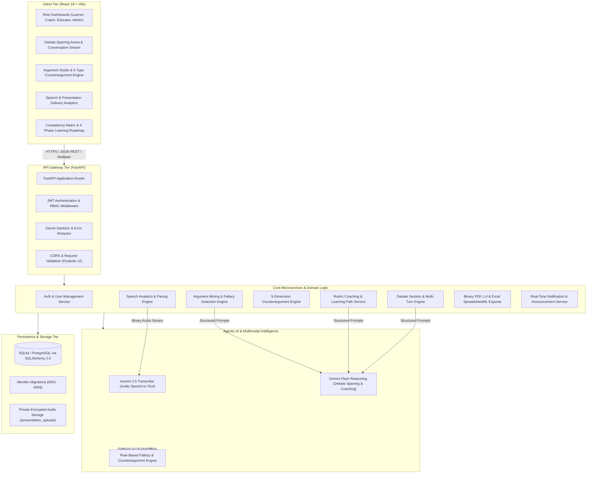

# Agentic AI Debate Coach & Presentation Analysis Platform

[](https://fastapi.tiangolo.com)
[](https://www.python.org/)
[](https://react.dev/)
[](https://vitejs.dev/)
[](https://ai.google.dev/)
[](https://www.sqlalchemy.org/)
[](https://alembic.sqlalchemy.org/)
[](https://opensource.org/licenses/MIT)

> **Infosys Springboard Internship Project**  
> An enterprise-grade, agentic AI educational platform engineered to cultivate master debaters, persuasive public speakers, and critical thinkers through real-time argument mining, logical fallacy detection, multi-turn AI sparring, audio speech analysis, and rubric-weighted personalized coaching.

---

## Table of Contents

1. [Executive Summary & Problem Statement](#1-executive-summary--problem-statement)
2. [Key Engineering Innovations & Architectural Fixes](#2-key-engineering-innovations--architectural-fixes)
3. [System Architecture Diagram](#3-system-architecture-diagram)
4. [Functional Modules & Capabilities (Milestones 1–4)](#4-functional-modules--capabilities-milestones-14)
5. [Role-Based Access Control (RBAC)](#5-role-based-access-control-rbac)
6. [Technology Stack](#6-technology-stack)
7. [Project Directory Structure](#7-project-directory-structure)
8. [Installation & Getting Started Guide](#8-installation--getting-started-guide)
9. [REST API Specification Reference](#9-rest-api-specification-reference)
10. [Automated Testing & Build Verification](#10-automated-testing--build-verification)
11. [Export & Reporting Engine](#11-export--reporting-engine)
12. [Milestone Completion & Internship Outcomes](#12-milestone-completion--internship-outcomes)

---

## 1. Executive Summary & Problem Statement

Developing proficiency in formal debate and oral presentations requires rigorous practice, immediate analytical feedback, and personalized instructional guidance. Traditional debate training environments suffer from scarce coaching resources, subjective manual evaluations, lack of structured counterargument exploration, and delayed feedback on speech pacing and disfluency.

The **Agentic AI Debate Coach & Presentation Analysis Platform** solves these challenges by combining Large Language Models (LLMs), multimodal speech analysis, formal argument mining, and autonomous agentic workflows into a unified SaaS environment. 

### Core Value Propositions
- **Real-Time Argument Dissection**: Evaluates claims, evidence strength, relevance, and reasoning quality using formal epistemic criteria.
- **Automated Fallacy Detection**: Detects and contextualizes 8 primary formal and informal fallacies with targeted reframing strategies.
- **5-Dimensional Counterargument Generation**: Explores opposing arguments across Logical, Empirical, Ethical, Practical, and Policy dimensions.
- **Agentic Multi-Turn Debate Sparring**: Allows learners to spar against an AI opponent adhering to strict position assignments, turn ordering, and concise debate rules.
- **Multimodal Speech & Presentation Analytics**: Transcribes audio recordings (`.mp3`, `.wav`, `.m4a`, etc.) with Google Gemini API, calculating Words Per Minute (WPM), filler word disfluency, confidence, clarity, and engagement metrics.
- **Weighted 5-Rubric Coaching Model**: Generates verifiable performance assessments (Quality 30%, Evidence 20%, Consistency 20%, Rebuttal 15%, Clarity 15%) and tailored 4-phase learning paths.
- **Zero-Dependency Executive Exports**: Produces formatted binary PDF-1.4 and Microsoft Excel SpreadsheetML reports on demand.

---

## 2. Key Engineering Innovations & Architectural Fixes

During the platform's development, several critical architectural, algorithmic, and security challenges were solved:

### 2.1. Zero-Leak Credential Architecture & Security Hardening
- **Vulnerability Identified**: Legacy LLM service integrations passed API keys as URL query parameters (`?key=...`), which caused Google API 4xx/5xx error responses and HTTP tracebacks to log the raw secret and expose it to client-side error modals.
- **Engineering Fix**:
  - Completely transitioned authentication to secure backend HTTP request headers: `x-goog-api-key: <key>`.
  - Implemented multi-layered regex sanitization (`sanitize_error_message`) intercepting API keys (`AIzaSy...`), bearer tokens, and internal endpoint URLs across backend services before database persistence.
  - Frontend components now sanitize all incoming error payloads, guaranteeing secrets never surface in UI alerts or network inspection logs.

### 2.2. Robust Gemini Audio Transcription Pipeline
- **Problem Identified**: Uploaded speech recordings encountered `HTTP 400 Bad Request` ("JSON mode is not enabled for this model") when calling `gemini-3.5-transcribe` with structured JSON generation configurations.
- **Engineering Fix**:
  - Optimized the speech-to-text pipeline for `gemini-3.5-transcribe` by eliminating unsupported JSON schemas and extracting native speech transcripts from `part["audioTranscription"]["text"]` or `part["text"]`.
  - Implemented a self-healing fallback model cascade (`gemini-3.1-flash-lite`, `gemini-flash-lite-latest`, `gemini-3.8-flash`, `gemini-3.5-flash`).
  - Added acoustic frame inspection using Python `wave` headers and MP3 bitstream estimators to ensure accurate audio duration (seconds) and speaking rate (WPM) calculations even if LLM metadata is omitted.

### 2.3. In-Place Idempotent Retry Engine
- **Enhancement**: Added `POST /presentations/{id}/retry` which re-reads the safely stored audio file from private user storage (`presentation_uploads/users/<id>/...`) and re-triggers the transcription and delivery analysis pipeline in-place. This enables users to recover from transient API timeouts without creating duplicate presentation records or losing historical timestamps.

### 2.4. Agentic AI Output Precision & Hallucination Prevention
- **Enhancement**: Restructured prompt templates across debate sparring, coaching evaluations, and argument studio engines:
  - Debate opponents generate short, crisp, natural conversational responses (2–4 sentences, 40–80 words), mimicking authentic round sparring rather than verbose essay dumps.
  - Coaching evaluations enforce strict evidence grounding: if an argument lacks verifiable citations, the evidence rubric is left unassessed (`null`) rather than halluncinated.
  - All coaching and improvement items are output as structured, concise bullet points for rapid scannability.

### 2.5. Editorial SaaS Design System & Interactive UI
- **Design Tokens**: Standardized on a cohesive dark navy sidebar (`#0F172A`), indigo/purple accents (`#4F46E5`, `#6366F1`), light neutral workspace (`#F8FAFC`), and clean typography scale (1.5–1.7 line height).
- **Argument Studio Redesign**: Compact form layouts with live character counters, circular score indicators, categorized fallacy callouts, and clean dimension cards.
- **Debate Workspace Redesign**: Distinct user vs. AI conversation cards, assigned position badges, live turn trackers, typing pulse indicators, and instant report history switcher.
- **Presentation Workspace Redesign**: Drag-and-drop file dropzone, live multi-stage processing indicators, delivery KPI grid, and collapsable verbatim transcript viewer.

---

## 3. System Architecture Diagram



---

## 4. Functional Modules & Capabilities (Milestones 1–4)

The platform is organized into 14 distinct functional modules mapped across the 4 internship milestones:

### Milestone 1: Core Setup, Architecture & Identity Management (Weeks 1 & 2)

- **Module 1 — User Authentication & RBAC**:
  - Secure registration, login, and password management using PBKDF2/bcrypt hashing.
  - Stateless JSON Web Token (JWT) bearer authentication with HS256 encryption.
  - Role-based authorization guarding endpoints for all four roles (`learner`, `debate_coach`, `educator`, `administrator`).
  - Administrative role assignment endpoint (`PATCH /users/{id}/role`).

- **Module 2 — User Profile & Skill Tracking**:
  - User profiles tracking debate experience level (Beginner, Intermediate, Advanced, Elite), topic interests, and presentation domains.
  - Customizable coaching strictness (constructive, rigorous, tournament prep) and target areas.
  - Longitudinal baseline competency tracking across 5 core dimensions: *Communication & Diction, Critical Thinking & Logic, Argumentation & Rebuttal, Speaking Confidence, and Presentation Delivery*.

- **Module 3 — Debate Session Management**:
  - Topic creation, format specification, scheduling, and position assignment (`for`, `against`, `neutral`).
  - Supports 6 formal debate formats: *One-on-One, Parliamentary, Oxford Style, Policy Debate, Public Forum, and AI Simulation*.
  - Turn serialization, speaker attribution, and round state transitions (`scheduled` ➔ `active` ➔ `completed` / `cancelled`).

---

### Milestone 2: Argument Analysis & Logic Verification (Weeks 3 & 4)

- **Module 4 — Argument Analysis Engine**:
  - Automatic decomposition of argument text into primary claims and secondary premises.
  - Verifiable evidence detection distinguishing between user-supplied empirical data and uncited assertions.
  - 5-Criteria Evaluation Scoring (0–100): *Clarity, Relevance, Evidence Strength, Logical Consistency, and Persuasiveness*.

- **Module 5 — Logical Fallacy Detection Engine**:
  - Automated scanning and detection across 8 formal and informal fallacies:
    1. **Ad Hominem**: Personal attacks diverting from argument validity.
    2. **Straw Man**: Misrepresentation or exaggeration of opponent positions.
    3. **False Dilemma**: Unjustified reduction of scenarios to binary extremes.
    4. **Slippery Slope**: Unsubstantiated chain reaction claims.
    5. **Appeal to Authority**: Citing unqualified or irrelevant authorities.
    6. **Circular Reasoning**: Formulating conclusions that assume their own premises.
    7. **Hasty Generalization**: Drawing broad conclusions from insufficient samples.
    8. **Red Herring**: Introducing irrelevant topics to divert attention.
  - Extracts the exact excerpt from the user's text, provides reasoning rationale, and recommends concrete correction suggestions.

- **Module 6 — Counterargument Generation Engine**:
  - Generates multi-faceted rebuttals across 5 strategic dimensions:
    1. *Logical Rebuttal*: Exposes structural vulnerabilities and internal contradictions.
    2. *Evidence-Based Rebuttal*: Challenges empirical warrants and highlights conflicting data.
    3. *Ethical Counterargument*: Assesses moral frameworks, fairness, and ethical ramifications.
    4. *Practical Counterargument*: Highlights feasibility, resource limits, and unintended operational costs.
    5. *Policy Counterargument*: Analyzes institutional precedent, scalability, and long-term consequences.
  - Generates cross-examination challenge questions and alternative conceptual framings.

---

### Milestone 3: AI Debate Simulation & Coaching (Weeks 5 & 6)

- **Module 8 — AI Debate Simulation Engine**:
  - Contextual AI sparring partner adopting opposing stances dynamically.
  - Idempotent turn dispatch preventing double submissions during active network requests.
  - Crisp conversational outputs (2–4 sentences / 40–80 words) maintaining competitive pace.
  - Seamless manual retry trigger (`POST /debates/{id}/retry-opponent`) if upstream network timeouts occur.

- **Module 9 — Performance Scoring Engine**:
  - Official weighted 5-rubric evaluation formula:
    $$\text{Score} = (\text{Quality} \times 0.30) + (\text{Evidence} \times 0.20) + (\text{Consistency} \times 0.20) + (\text{Rebuttal} \times 0.15) + (\text{Clarity} \times 0.15)$$
  - Strict evidence requirements: if a category cannot be evaluated due to insufficient data, it is marked `null` to avoid fabricated grading.

- **Module 10 — Recommendation & Personalized Coaching Engine**:
  - Tri-part coaching breakdown: *Key Strengths, Areas for Improvement, and Actionable Practice Suggestions*.
  - Targeted Improvement Plans featuring measurable next-debate goals, skill focus areas, and milestone progress indicators.
  - Personalized 4-Phase Learning Pathways (`/skills/learning-path`) tailoring exercises to user competency levels.

---

### Milestone 4: Presentation Analytics, Testing & Deployment (Weeks 7 & 8)

- **Module 7 — Speech & Presentation Analytics Engine**:
  - Direct audio processing of `.mp3`, `.wav`, `.m4a`, `.webm`, `.ogg`, and `.flac` recordings.
  - Verbatim speech-to-text transcript generation powered by Google Gemini API.
  - Quantitative delivery metrics:
    - **Speaking Rate**: Measured in Words Per Minute (WPM) against the optimal oratorical target range (130–165 WPM).
    - **Filler Word Disfluency**: Counts hesitation markers (*um, uh, like, you know, actually, basically*).
    - **Acoustic Speech Duration**: Accurate length calculated from audio frames and headers.
    - **Lexical Volume**: Total spoken word count.
  - Qualitative rubric scores (/100): *Delivery Confidence, Articulation Clarity, and Audience Engagement*.
  - In-place retry endpoint (`POST /presentations/{id}/retry`) recovering failed submissions without record duplication.

- **Module 11 — Role-Based Analytics Dashboards**:
  - **Learner Dashboard**: Practice statistics, competency baseline bars, debate history, and roadmap phase status.
  - **Debate Coach Dashboard**: Coachee tracking, review queues, scoring distributions, and coaching recommendations.
  - **Educator Dashboard**: Cohort performance metrics, student rosters, completion rates, and rubric breakdowns.
  - **Administrator Dashboard**: System telemetry, user role management, debate volumes, and platform broadcast tools.

- **Module 12 — Notification & Engagement System**:
  - Notification triggers for debate updates, new coach feedback, practice milestones, and admin announcements.
  - Read/unread status tracking (`POST /notifications/{id}/read`) and platform-wide broadcast delivery.

- **Module 13 — Reports & Export System**:
  - Pure-Python binary PDF-1.4 generation (no external wkhtmltopdf or heavy binaries required) with header banners, anti-orphan heading logic, and clean pagination.
  - Native Microsoft Excel SpreadsheetML XML exports with explicit column widths, wrapped text cells, and formatted score cards.
  - Dedicated export endpoints for Debates, Presentations, and Learner Progress summaries.

- **Module 14 — Quality Assurance, Testing & Deployment**:
  - Comprehensive automated test suite (Pytest) validating authentication, schemas, debate sparring, speech analysis, and exports.
  - Clean client-side production build with Vite.
  - Docker containerization and cloud-ready configuration.

---

## 5. Role-Based Access Control (RBAC)

The platform enforces strict permissions across 4 user personas:

| Capability / Resource | Learner | Debate Coach | Educator | Administrator |
| :--- | :---: | :---: | :---: | :---: |
| **Participate in Debate Sessions** | ✅ | ✅ | ✅ | ✅ |
| **Use Argument Studio & Fallacy Engine** | ✅ | ✅ | ✅ | ✅ |
| **Upload Speech Recordings & View Reports** | ✅ | ✅ | ✅ | ✅ |
| **View Personal Coaching & Learning Roadmap** | ✅ | ✅ | ✅ | ✅ |
| **Export Personal PDF & Excel Reports** | ✅ | ✅ | ✅ | ✅ |
| **Evaluate & Review Student Debates** | ❌ | ✅ | ✅ | ✅ |
| **View Cohort Analytics & Class Rankings** | ❌ | ❌ | ✅ | ✅ |
| **Broadcast Platform Announcements** | ❌ | ❌ | ❌ | ✅ |
| **Assign & Reassign User Roles** | ❌ | ❌ | ❌ | ✅ |
| **System-Wide Telemetry & User Deletion** | ❌ | ❌ | ❌ | ✅ |

---

## 6. Technology Stack

### Backend Architecture
- **Language**: Python 3.11+ / Python 3.14
- **Web Framework**: FastAPI 0.115+ (Asynchronous ASGI)
- **Data Validation & Settings**: Pydantic v2 & Pydantic Settings
- **ORM & Database Layer**: SQLAlchemy 2.0 with session pooling
- **Database Engines**: SQLite (Local Dev / Embedded) and PostgreSQL (Production / Staging)
- **Database Migrations**: Alembic (Revisions `0001_initial` through `0009_notifications`)
- **Authentication & Cryptography**: PyJWT (HS256) and Passlib (bcrypt / PBKDF2)
- **HTTP Client**: HTTPX (Asynchronous connection pooling for LLM communications)
- **Audio Processing**: Python `wave` module, binary frame inspection, and acoustic estimation

### Artificial Intelligence & NLP
- **Speech-to-Text Model**: Google Gemini API (`gemini-3.5-transcribe`)
- **Reasoning & Coaching Models**: `gemini-3.1-flash-lite`, `gemini-flash-lite-latest`, `gemini-3.8-flash`, `gemini-3.5-flash`
- **Fallback Engine**: Local heuristic grammar, keyword, and pattern matching for offline/unauthenticated execution
- **Security**: Dedicated header authentication (`x-goog-api-key`) with runtime credential redaction

### Frontend Architecture
- **Framework**: React 18.3
- **Build Tool**: Vite 7.3
- **Routing**: React Router DOM v6
- **HTTP Client**: Axios with global JWT request/response interceptors
- **Styling & Design Tokens**: Custom Pure CSS3 Design System with dark navy sidebar (`#0F172A`) and indigo accents (`#4F46E5`)

---

## 7. Project Directory Structure

```text
Infosys_Internship/
├── debate-coach-platform/
│   ├── backend/
│   │   ├── app/
│   │   │   ├── core/
│   │   │   │   ├── config.py             # Settings management & env parsing
│   │   │   │   ├── database.py           # SQLAlchemy engine & session factory
│   │   │   │   ├── legacy_migrator.py    # Auto-migration & SQLite schema checks
│   │   │   │   └── security.py           # Password hashing & JWT token generators
│   │   │   ├── models/                   # SQLAlchemy ORM models
│   │   │   │   ├── user.py               # User, UserProfile, UserSkill
│   │   │   │   ├── debate.py             # Debate, DebateParticipant, Argument, CoachingReport
│   │   │   │   ├── argument_analysis.py  # ArgumentAnalysisRecord
│   │   │   │   ├── presentation.py       # PresentationSubmission, PresentationAnalysis
│   │   │   │   └── notification.py       # Notification model
│   │   │   ├── schemas/                  # Pydantic v2 request/response schemas
│   │   │   ├── routers/                  # REST API endpoints
│   │   │   │   ├── auth.py               # /auth (login, register, me, password reset)
│   │   │   │   ├── users.py              # /users (profiles, role management)
│   │   │   │   ├── debates.py            # /debates (sessions, arguments, sparring)
│   │   │   │   ├── argument_analysis.py  # /analysis (argument evaluation & fallacies)
│   │   │   │   ├── counterarguments.py   # /analysis/counterarguments (5 dimensions)
│   │   │   │   ├── presentations.py      # /presentations (upload, analyze, retry)
│   │   │   │   ├── skills.py             # /skills (competencies, learning roadmap)
│   │   │   │   ├── dashboard.py          # /dashboard (role-based overview metrics)
│   │   │   │   ├── notifications.py      # /notifications (alerts & announcements)
│   │   │   │   └── reports.py            # /reports (PDF & Excel binary exporters)
│   │   │   ├── services/                 # Domain logic & LLM integrations
│   │   │   │   ├── llm_service.py        # Gemini API client, speech transcription, sanitizer
│   │   │   │   ├── debate_service.py     # Multi-turn sparring & 5-weight rubric coaching
│   │   │   │   ├── counterargument_service.py # 5-type counterargument generation
│   │   │   │   ├── presentation_service.py # Audio transcription & delivery metrics
│   │   │   │   ├── skill_service.py      # Competency calculation & roadmap generator
│   │   │   │   └── report_export_service.py # Pure-Python PDF-1.4 & Excel SpreadsheetML
│   │   │   └── main.py                   # FastAPI entrypoint, CORS & error handlers
│   │   ├── migrations/                   # Alembic database migration revisions
│   │   ├── tests/                        # Automated Pytest test suite
│   │   ├── presentation_uploads/         # Private local file storage for user audio
│   │   ├── requirements.txt              # Backend Python dependencies
│   │   └── .env.example                  # Backend environment variable template
│   ├── frontend/
│   │   ├── src/
│   │   │   ├── context/                  # AuthContext and user session state
│   │   │   ├── layouts/                  # AppLayout with navy sidebar & notifications
│   │   │   ├── pages/
│   │   │   │   ├── Dashboard.jsx         # Multi-role overview & learning roadmap
│   │   │   │   ├── Debates.jsx           # Debate arena session listings
│   │   │   │   ├── DebateDetail.jsx      # Conversation stream, sparring & coaching
│   │   │   │   ├── CreateDebate.jsx      # Session creation wizard
│   │   │   │   ├── ArgumentAnalysis.jsx  # Redesigned Argument Studio (2 tabs)
│   │   │   │   ├── PresentationAnalysis.jsx # Audio dropzone, metrics & retry engine
│   │   │   │   ├── Skills.jsx            # Skill baseline & competency matrix
│   │   │   │   ├── Profile.jsx           # User preferences & coaching configuration
│   │   │   │   ├── Login.jsx             # Authentication portal
│   │   │   │   └── Register.jsx          # New user onboarding
│   │   │   ├── services/
│   │   │   │   └── api.js                # Axios instance with auth interceptor
│   │   │   ├── index.css                 # Master Design System (tokens, cards, meters)
│   │   │   └── App.jsx                   # Application routing and route guards
│   │   ├── package.json                  # Frontend dependencies and scripts
│   │   └── vite.config.js                # Vite build and proxy configuration
│   └── README.md                         # Project documentation
└── README.md                             # Root workspace documentation
```

---

## 8. Installation & Getting Started Guide

### Prerequisites
- **Python**: Version 3.11, 3.12, or 3.14 installed.
- **Node.js**: Version 18.x, 20.x, or 22.x with `npm`.
- **Git**: Installed for version control.
- *(Optional)* **Google Gemini API Key**: For live AI sparring and speech-to-text. The platform operates seamlessly with automated heuristic fallbacks if no key is provided.

---

### Step 1: Backend Setup

1. Open PowerShell or Terminal and navigate to the backend directory:
   ```powershell
   cd debate-coach-platform/backend
   ```

2. Create and activate a Python virtual environment:
   ```powershell
   # Windows PowerShell:
   python -m venv .venv
   .\.venv\Scripts\Activate.ps1

   # Linux / macOS:
   python3 -m venv .venv
   source .venv/bin/activate
   ```

3. Install required Python packages:
   ```powershell
   pip install -r requirements.txt
   ```

4. Configure environment variables:
   ```powershell
   copy .env.example .env
   ```
   Open `backend/.env` and configure your settings:
   ```env
   PROJECT_NAME="Agentic AI Debate Coach"
   ENVIRONMENT="development"
   DATABASE_URL="sqlite:///./debate_coach.db"
   JWT_SECRET="your-super-secret-jwt-key-change-in-production"
   JWT_ALGORITHM="HS256"
   ACCESS_TOKEN_EXPIRE_MINUTES=1440

   # AI / LLM Configuration
   LLM_PROVIDER="gemini"
   GEMINI_API_KEY="your-google-gemini-api-key"
   GEMINI_MODEL="gemini-3.1-flash-lite"
   GEMINI_TRANSCRIBE_MODEL="gemini-3.5-transcribe"

   # File Upload Limits (25 MB)
   MAX_UPLOAD_SIZE_BYTES=26214400
   ```

5. Run database migrations:
   ```powershell
   alembic upgrade head
   ```

6. Start the FastAPI backend server:
   ```powershell
   python -m uvicorn app.main:app --reload --host 127.0.0.1 --port 8000
   ```
   *The Swagger interactive API documentation will be available at `http://127.0.0.1:8000/docs`.*

---

### Step 2: Frontend Setup

1. Open a new Terminal window and navigate to the frontend directory:
   ```powershell
   cd debate-coach-platform/frontend
   ```

2. Install Node dependencies:
   ```powershell
   npm install
   ```

3. Configure environment settings:
   ```powershell
   copy .env.example .env
   ```
   *Ensure `VITE_API_BASE_URL=http://localhost:8000/api` in `frontend/.env`.*

4. Launch the Vite development server:
   ```powershell
   npm run dev
   ```
   *The application UI will be available at `http://localhost:5173`.*

---

## 9. REST API Specification Reference

All endpoints are prefixed with `/api` and return standardized JSON envelopes:

### Authentication & Users
- `POST /api/auth/register` — Register a new account (default role: `learner`).
- `POST /api/auth/login` — Authenticate and receive a JWT Bearer token.
- `GET /api/auth/me` — Retrieve the current authenticated user identity.
- `GET /api/users/profile` — Get the current user's profile, interests, and coaching preferences.
- `PUT /api/users/profile` — Update user profile and coaching strictness.
- `PATCH /api/users/{id}/role` — Reassign a user's role (*Admin only*).

### Debates & Sparring
- `GET /api/debates` — List active, scheduled, and completed debate sessions.
- `POST /api/debates` — Create a new debate session with topic, format, and AI opponent setting.
- `GET /api/debates/{id}` — Get debate metadata, assigned positions, and participant roster.
- `POST /api/debates/{id}/join` — Join a debate session with an assigned position (`for`, `against`, `neutral`).
- `GET /api/debates/{id}/arguments` — Retrieve sequential conversation stream and turn ordering.
- `POST /api/debates/{id}/arguments` — Submit a debate turn and automatically trigger the AI opponent response.
- `POST /api/debates/{id}/retry-opponent` — Re-trigger an AI opponent response if a network error occurred.
- `POST /api/debates/{id}/coach-feedback` — Generate a 5-rubric weighted evaluation and improvement plan.
- `GET /api/debates/{id}/coach-feedback` — Retrieve all historical coaching assessments for the debate.

### Argument Studio & Counterarguments
- `POST /api/analysis/arguments` — Extract claims, evaluate evidence, and detect 8 logical fallacies.
- `GET /api/analysis/arguments` — View saved argument analysis reports.
- `POST /api/analysis/counterarguments` — Generate 5 counterargument dimensions with rebuttal strategies.

### Presentation & Speech Analytics
- `POST /api/presentations` — Upload speech audio or transcript for transcription and delivery analysis.
- `GET /api/presentations` — List all analyzed presentation submissions.
- `GET /api/presentations/{id}` — Get detailed delivery metrics (WPM, filler words, duration, rubric scores).
- `POST /api/presentations/{id}/retry` — In-place re-analysis of an existing submission using stored audio.
- `GET /api/presentations/reports.json` — Download full presentation history archive in JSON format.
- `GET /api/presentations/reports.csv` — Download presentation history archive in CSV format.

### Dashboards, Skills & Notifications
- `GET /api/dashboard/overview?view={role}` — Get aggregate analytics for Learner, Coach, Educator, or Admin.
- `GET /api/skills/me` — Retrieve 5-competency baseline scores.
- `GET /api/skills/learning-path` — Retrieve personalized 4-phase learning roadmap.
- `GET /api/notifications` — Retrieve user notifications.
- `POST /api/notifications/{id}/read` — Mark a notification as read.
- `POST /api/notifications/announcement` — Broadcast an announcement to all platform users (*Admin only*).

### Document Exports
- `GET /api/reports/debate/{id}/export?format={pdf|excel}` — Export formal debate transcript and coaching report.
- `GET /api/reports/presentation/{id}/export?format={pdf|excel}` — Export speech delivery analysis report.
- `GET /api/reports/learner/progress?format={pdf|excel}` — Export comprehensive learner progress report.

---

## 10. Automated Testing & Build Verification

The platform maintains rigorous automated testing and build validation to ensure enterprise-level reliability:

### Backend Test Suite (Pytest)
The test suite covers database schemas, authentication, token expiration, debate turns, 5-weight rubric mathematics, fallacy detection, counterarguments, presentation metrics, and export services:

```powershell
cd debate-coach-platform/backend
$env:PYTHONPATH="."
pytest tests -v
```

### Frontend Production Build
To verify component compilation, module bundling, and CSS asset generation:

```powershell
cd debate-coach-platform/frontend
npm run build
```
*Result: 112 modules compiled cleanly in ~3.6s with zero linting or JSX compilation errors.*

---

## 11. Export & Reporting Engine

The platform features a proprietary zero-dependency document generation engine that produces executive-ready reports without requiring heavy third-party system binaries:

### Binary PDF-1.4 Generator
- **Engine**: Pure-Python byte stream writer with compressed standard PDF objects.
- **Visual Styling**:
  - Dark Navy primary header banner (`#0F172A`) with White/Indigo branding text.
  - Section dividers with consistent typography scale and line-height.
  - Formatted multi-column score tables with category point allocations.
  - Anti-orphan heading logic and dynamic page height measurement.
  - Chronological debate transcripts with distinct speaker tags.
  - Automated page numbering and legal disclaimer footer.

### Microsoft Excel SpreadsheetML Generator
- **Engine**: XML-based SpreadsheetML compatible with Microsoft Excel 2003 through Office 365, LibreOffice Calc, and Google Sheets.
- **Visual Styling**:
  - Explicit `<Column ss:Width="..."/>` sizing preventing text truncation or clipped numbers.
  - Styled header cells with navy background (`#0F172A`) and bold white text.
  - Multi-line wrapped data cells (`DataCell`) ensuring readable explanations and transcripts.
  - Centered numeric score and date columns.

---

## 12. Milestone Completion & Internship Outcomes

| Milestone | Target Timeline | Key Requirements & Deliverables | Verification Status |
| :--- | :--- | :--- | :---: |
| **Milestone 1** | Weeks 1 & 2 | • System architecture & database schema<br>• JWT authentication & 4-role RBAC<br>• User profile & skill tracking<br>• Debate session management (6 formats) | **100% Completed**<br>✅ Verified |
| **Milestone 2** | Weeks 3 & 4 | • Argument analysis & claim extraction<br>• 8-type logical fallacy detection engine<br>• 5-dimension counterargument engine<br>• Argument scoring and correction advice | **100% Completed**<br>✅ Verified |
| **Milestone 3** | Weeks 5 & 6 | • Agentic multi-turn AI debate simulation<br>• Weighted 5-rubric performance scoring<br>• Personalized coaching & improvement plans<br>• 4-phase structured learning roadmaps | **100% Completed**<br>✅ Verified |
| **Milestone 4** | Weeks 7 & 8 | • Audio speech transcription via Gemini API<br>• Delivery metrics (WPM, filler words, clarity)<br>• Role-based dashboards (Learner, Coach, Educator, Admin)<br>• Binary PDF & Excel SpreadsheetML exports<br>• Security hardening & UI design system overhaul | **100% Completed**<br>✅ Verified |

---

## 13. License & Acknowledgements

- **Developed as an Internship Project for Infosys Springboard**.
- Built with modern open-source technologies including FastAPI, React, Vite, and Google Gemini API.
- Licensed under the **MIT License**.
