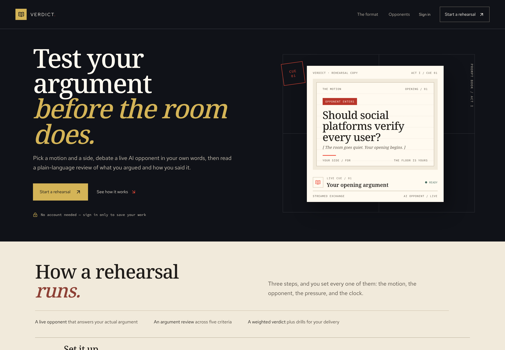
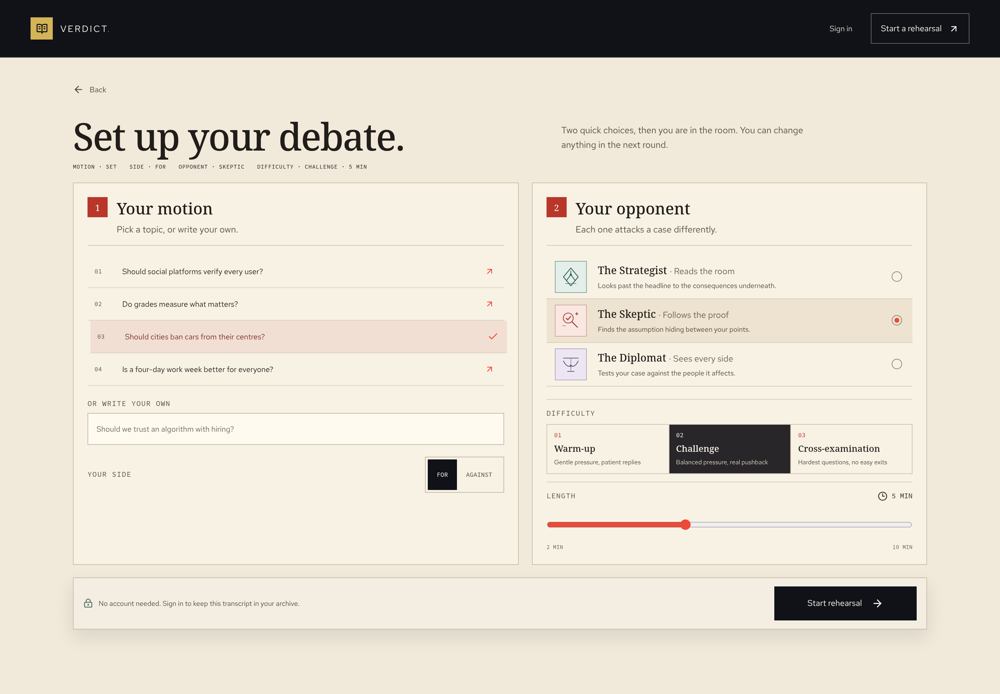
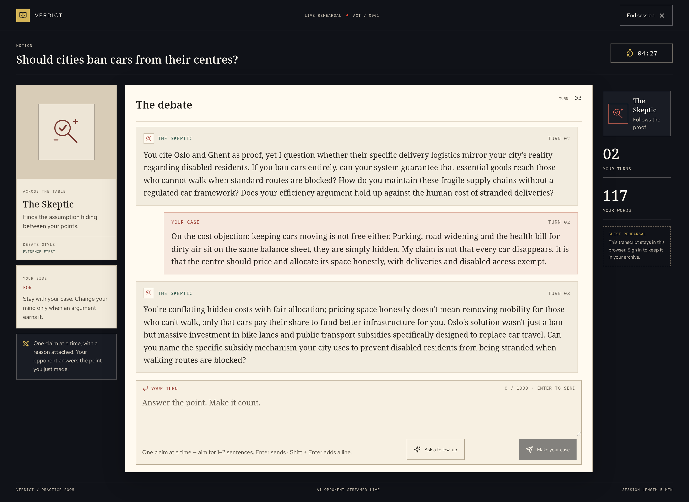
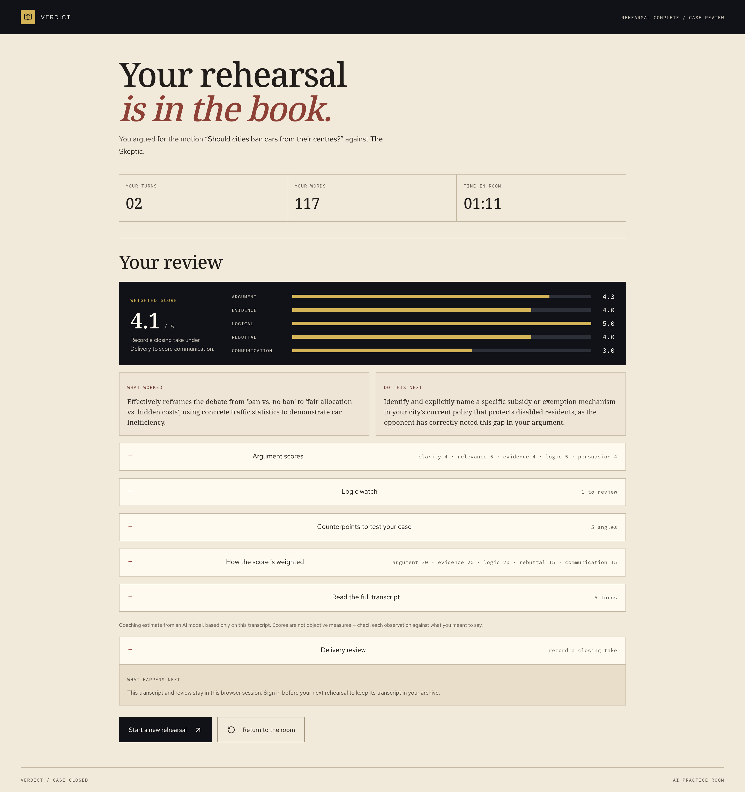

# Verdict

**Debate practice, with a point of view.**

Verdict is an AI debate coach for students and self-directed learners. Choose a motion, take a side, and argue it live against an opponent with a distinct personality — then get coaching on both what you argued and how you sounded saying it.

No account is required. Open the app, finish a practice round in a few minutes, and leave with clear next steps for your next debate.



---

## What you can do

**Rehearse a live debate.** Choose a motion from your topic bank or write your own, argue for or against, pick one of three opponents (Strategist, Skeptic, Diplomat), set the pressure and a 2–10 minute clock, then trade turns with streamed replies. The opponent plans against your weakest joint, remembers what your saved sessions showed was weak, adapts its pressure to how you argue, and can press Socratic follow-ups two deep.

**Review your arguments.** Every rehearsal gets ratings on clarity, relevance, evidence, logic, and persuasion, fallacy flags quoted from your exact words, and five counterpoints that test your case from other angles.

**Get a weighted verdict.** Argument, evidence, logic, rebuttal, and communication are scored 30/20/20/15/15, each with a line of coaching behind it. The logic score names the fallacy quotes it caught, and communication carries timestamps from your delivery review when there is one.

**Review your delivery.** Record or upload a closing take of up to three minutes. You get pace, filler, and pause signals with timestamps you can replay, plus short drills built around what the recording actually shows. Audio is discarded after the review unless you choose to keep it.

**Follow a practice plan.** The Plan tab reads your saved sessions, names the criteria your own scores say are weakest, and drafts a drill for each, a four-week rhythm, and the one thing to work on next.

**Track your progress.** Your learner space holds your archive, a profile with goals and audio preferences, and trends across sessions, streaks, average scores, and filler direction. Export sessions as CSV or print a report.

**Keep your work.** A free account with email or Google saves transcripts and reviews to your archive; password recovery is built in. Guests keep everything in the browser.

---

## A round, end to end

**Set the terms.** Choose a motion from your bank or write your own, take a side, pick the opponent who attacks a case the way you find hardest, and set the pressure and the clock.



**Argue it live.** Your turns and the opponent's replies stream into a single transcript, with your own turn and word counts kept beside it and the clock still running.



**Read the verdict.** Five weighted dimensions, each with the reasoning behind the score, followed by the fuller review underneath.



---

## How it works

1. You type an argument in the browser and send it to the API.
2. Five agents answer a turn: a deterministic guard routes jailbreaks and off-motion tasks to an in-character redirect with no model call, a memory agent reduces your saved history into a private brief, a planner names the weakest joint in the transcript, the responder streams an in-persona reply, and a verifier inspects it for length, role labels, character breaks, leaked brief text, and whether it actually engaged your latest point. A flagged turn is repaired once; a turn that still fails is replaced rather than shipped.
3. Coaching fans rubric scoring, fallacy detection, and counterpoints into parallel branches that merge into one review. Every fallacy quote is matched against your own words, and contact details are redacted from saved reports.
4. The practice plan diagnoses weak spots from your scores, writes a drill for each, and refuses to invent weaknesses, scores, or session counts that your record does not support.
5. Delivery review transcribes your audio to timestamped words, counts pace, fillers, pauses, and repeats in pure Python, and turns those signals into drills.

The model only ever receives text through the API. The browser never talks to a model directly.

---

## Architecture

| Layer | Built with | Notes |
| --- | --- | --- |
| Web app | React 19, TypeScript, Vite | Landing, setup, live arena, verdict, delivery room, learner space |
| API | Python 3.12, FastAPI, Pydantic, LangGraph | All model calls, orchestration, and validation live here |
| Inference | Ollama (`qwen3.5:4b` by default) | Any endpoint reachable at `OLLAMA_BASE_URL` |
| Speech | `faster-whisper` (optional) | Local transcription for delivery review |
| Accounts and storage | Supabase (free tier) | Auth, Postgres with row level security, private audio bucket |

---

## Run it locally

You need Node.js 20 or newer, Python 3.12, `uv`, and Ollama.

**1. Start Ollama and pull the model**

```bash
ollama pull qwen3.5:4b
```

If Ollama does not start on its own, run `ollama serve` in a terminal and leave it open. Confirm it with `curl http://127.0.0.1:11434/api/tags`.

**2. Start the API**

```bash
cd ai-backend
cp .env.example .env
uv sync
uv run uvicorn app.main:app --reload --host 127.0.0.1 --port 8000
```

The defaults already point at your local Ollama and allow the local web app. For delivery review, install the speech extra with `uv sync --extra stt`.

**3. Start the web app**

```bash
cd web
npm install
npm run dev
```

Open `http://127.0.0.1:5173`.

**4. Optional: enable accounts**

Practice works without this. To save sessions to an archive, create a Supabase project, put its project URL and publishable key in `web/.env`, put the project URL in `ai-backend/.env` as `SUPABASE_URL`, and run the SQL files in `supabase/migrations/` in filename order. Keep email confirmation on, set the password rule to 12 or more characters with uppercase, lowercase, and numbers, and add `http://127.0.0.1:5173` to the redirect allowlist. Google sign-in is configured in the Supabase provider settings, where the client secret stays.

---

## Docker

One command starts the API, the web app, and an Ollama service with the model pulled:

```bash
docker compose up --build          # then open http://localhost:8080
```

The first run downloads the Ollama image and about 3.4 GB of model. The web container serves the built app and proxies `/api` to the API, so the browser only ever talks to one origin. Accounts stay optional: copy `.env.docker.example` to `.env` and fill in your Supabase values to enable them.

Already running Ollama on the host? Reuse it instead of the bundled service:

```bash
docker compose up api web          # with OLLAMA_BASE_URL=http://host.docker.internal:11434 in .env
```

Add `EXTRAS=--extra stt` to `.env` to build the API image with local transcription.

---

## Configuration

Set these in `ai-backend/.env` (see `.env.example`) unless noted.

| Variable | Default | Purpose |
| --- | --- | --- |
| `OLLAMA_BASE_URL` | `http://127.0.0.1:11434` | Model endpoint the API calls |
| `OLLAMA_MODEL` | `qwen3.5:4b` | Model name to expect and request |
| `WEB_ORIGIN` | `http://127.0.0.1:5173` | Exact allowed browser origins, comma separated; wildcards are rejected |
| `ALLOWED_HOSTS` | `localhost,127.0.0.1,0.0.0.0` | Hosts the API will answer for |
| `REQUIRE_AUTH` | `false` | Set to `true` with Supabase configured before any public deployment |
| `SUPABASE_URL` | empty | Enables token verification for signed-in requests |
| `SUPABASE_JWKS_URL` | derived | Override only if you serve JWKS elsewhere |
| `MAX_ACTIVE_STREAMS` | `2` | Concurrent model streams per process before requests are answered with 429 |
| `PLANNER_EVERY_N_TURNS` | `2` | How often the opponent re-plans against your weakest joint |
| `STT_MODEL` | `tiny` | Whisper size for delivery review |
| `MAX_AUDIO_MB` / `MAX_AUDIO_SEC` | `10` / `180` | Upload caps |
| `ENABLE_SER` | `false` | Local-only emotion recognition; leave off on anything public |
| `LOG_LEVEL` | `INFO` | Agent and timing logs |

In `web/.env`: `VITE_API_BASE_URL` (blank uses the dev proxy or a same-origin `/api`), `VITE_SUPABASE_URL`, and `VITE_SUPABASE_PUBLISHABLE_KEY`. Only public values belong in `VITE_` variables — they ship inside the browser bundle.

---

## API

| Method and path | Purpose |
| --- | --- |
| `GET /api/health` | Model readiness |
| `POST /api/debate/stream` | Streams one opponent reply over server-sent events, ending with `[DONE]` |
| `POST /api/debate/analyze` | Argument review: ratings, fallacy flags, counterpoints, disclosed gaps |
| `POST /api/debate/challenge` | One Socratic follow-up, or done at depth 2 |
| `POST /api/debate/judge` | Weighted verdict with citations; deterministic, no model call |
| `POST /api/coach/plan` | Practice plan from your own record, grounded in diagnosed weak spots |
| `POST /api/presentation/analyze` | Audio upload plus optional motion; returns transcript, delivery signals, and drills |

With `REQUIRE_AUTH=true`, every endpoint except health requires a signed-in token.

---

## Deployment

The web app builds to static files, so it can be hosted anywhere. A Render blueprint is included as `render.yaml`, and `web/vercel.json` carries the same headers for Vercel, including a content security policy, immutable caching for hashed assets, and `microphone=(self)` for recording.

The API needs a host that can run a container and reach a model endpoint. Point `VITE_API_BASE_URL` at its HTTPS origin, set `WEB_ORIGIN` and `ALLOWED_HOSTS` to the exact origins you serve from, and turn on `REQUIRE_AUTH=true` with Supabase configured.

Two things are deliberately not in this release: managed multi-tenant inference, and per-learner provider keys for hosted generation. Until a deployment has its own authenticated API in front of a model, keep it private.

---

## Privacy and security

- Prompt construction, model calls, transcription, and coaching happen server-side. The browser never talks to a model directly.
- Signed-in data is owner-scoped by Postgres row level security. The API holds no database credential, so a leaked API token cannot read another learner's archive.
- API replies carry `no-store` headers; the service starts only with explicit origins and hosts, and rejects wildcards.
- Request sizes are bounded, concurrent streams are capped, and learner text is always treated as data, never as instructions.
- Recorded audio is discarded immediately after review unless the learner opts into retention, in which case it is stored in a private per-owner bucket.
- Contact details are redacted from saved coaching reports, and categorical emotion recognition stays local and off by default.

---

## Project layout

- `web/src/` — views, API clients, session handling, and styles. `features/` holds the arena, verdict, delivery room, learner space, and onboarding; `services/` holds typed API and Supabase clients.
- `ai-backend/app/` — routes in `main.py`, request schemas, the Ollama client, auth, speech, delivery signals, and the `agents/` graphs that orchestrate a debate turn, a review, a delivery pass, and a practice plan.
- `supabase/migrations/` — sessions, turns, analyses, delivery feedback, profiles, topic bank, learning plans, and the private audio bucket, each with owner-scoped access rules.
- `docker-compose.yml`, `ai-backend/Dockerfile`, `web/Dockerfile` — the whole stack in containers, with an nginx front end that proxies `/api` and streams server-sent events unbuffered.
- `ai-backend/.env.example`, `web/.env.example`, `.env.docker.example` — every setting above with safe defaults.

---

## License

MIT. See `LICENSE`.
