# DebateIQ: Agentic AI Debate Coach & Presentation Analysis Platform

[]()
[]()
[]()
[]()
[]()

**DebateIQ** is an enterprise-grade Agentic AI debate coaching and argumentation intelligence platform. It trains students, competitive debaters, trainers, and educators through interactive AI opponent sparring, syllogistic argument decomposition, canonical fallacy detection with guided rewrites, multi-perspective counterargument generation, and objective weighted scoring.

---

## 🏛️ System Architecture

```mermaid
flowchart TD
    subgraph UI ["Frontend (React 19 + TypeScript + Vite + Tailwind CSS)"]
        ArenaView["Debate Arena (Live AI Opponent Sparring)"]
        ArgLabView["Argument Lab & 'Argument X-Ray' Mode"]
        FallacyArena["Fallacy Arena (8 Canonical Fallacies + Rewrites)"]
        RebuttalView["Multi-Perspective Rebuttal Matrix (5 Strategic Tabs)"]
        CoachingHub["Coaching Hub & Speed Skill Drills"]
        Dashboards["Role Dashboards (Learner, Coach, Educator, Admin)"]
    end

    subgraph API ["FastAPI Gateway & Security (/api/v1)"]
        AuthRouter["/auth (JWT, Refresh Tokens, Google SSO)"]
        ProfilesRouter["/profiles & /skills & /goals"]
        DebatesRouter["/debates (6 Formats, Topics, Sessions, Turns)"]
        AnalysisRouter["/analysis (Arguments, Fallacies, Rebuttals, Reports)"]
        SimulationRouter["/simulation (Sparring, Personas, Whispers)"]
        ScoringRouter["/scoring (Exact Weighted 30/20/20/15/15 Engine)"]
        DashboardsRouter["/dashboards (Learner, Coach, Educator, Admin)"]
    end

    subgraph AgenticCore ["Agentic AI Framework (app/agents)"]
        Planner["AgentPlanner (Workflow Orchestrator)"]
        ArgAgent["ArgumentAnalyzerAgent (Claim/Premise/Evidence Mining)"]
        FalAgent["FallacyDetectorAgent (8 Canonical Fallacies)"]
        RebAgent["RebuttalAgent (5 Strategic Counterarguments)"]
        OppAgent["OpponentAgent (Socratic, Professor, Politician)"]
        ScrAgent["ScoringAgent (Exact Weighted Formula Evaluator)"]
        CchAgent["CoachAgent (Drills, Learning Plans, Real-Time Whispers)"]
    end

    subgraph DataStore ["Database & Persistence (PostgreSQL / SQLite)"]
        UsersDB[("users, profiles, skills, goals")]
        DebatesDB[("topics, debate_sessions, turns")]
        AnalysisDB[("argument_findings, fallacy_findings, scores, reports")]
    end

    UI --> API
    API --> AgenticCore
    API --> DataStore
    AgenticCore --> DataStore
```



---

## 🚀 Quickstart Guide

### Option A: Local Development (Instant SQLite + Mock AI)

No API keys or external database installations required. The platform runs 100% offline out-of-the-box.

#### 1. Backend Setup
```bash
cd debateiq/backend
python -m venv venv
# On Windows:
venv\Scripts\activate
# On Linux/macOS:
source venv/bin/activate

pip install -r requirements.txt
python -m pytest tests/ -v   # Run test suite (17/17 passing)
uvicorn app.main:app --host 127.0.0.1 --port 8000
```
- Interactive Swagger API: **`http://127.0.0.1:8000/docs`**
- Health Check: **`http://127.0.0.1:8000/api/health`**

#### 2. Frontend Setup
In a separate terminal:
```bash
cd debateiq/frontend
npm install
npm run dev
```
- Open application: **`http://127.0.0.1:5173`**

---

### Option B: Containerized Deployment (Docker Compose)
Runs PostgreSQL 16, FastAPI backend, and React production frontend in isolated containers:
```bash
cd debateiq
docker compose up --build
```
- Frontend: `http://localhost:3000`
- Backend API: `http://localhost:8000/docs`

---

## 👥 Pre-Seeded Demo User Accounts

All demo accounts share the password: **`password123`**

| Role | Name | Email | Default Dashboard & Capabilities |
|---|---|---|---|
| **Learner** | Alex Rivera | `learner@debateiq.ai` | Debate Arena, Argument X-Ray, Fallacy Arena, Skill Radar, Level 2 (450 XP), 5d Streak |
| **Debate Coach** | Dr. Marcus Vance | `coach@debateiq.ai` | Student Progress Monitoring, Cohort Skill Gap Analysis, Recalibrate Scores |
| **Educator** | Prof. Elena Rostova | `educator@debateiq.ai` | Class Analytics, Format Mastery Breakdown, Cohort Growth (+14.2%) |
| **Administrator** | System Admin | `admin@debateiq.ai` | Platform Governance, User Management, AI Model Gateway Telemetry |

*(Tip: You can switch between these personas instantly via the top-right persona dropdown menu in the UI).*

---

## 📊 Exact Weighted Performance Scoring Model

DebateIQ implements the exact weighted adjudication formula specified in the platform blueprint:

$$\text{Debate Performance Score} = 0.30 \times \text{Argument Quality} + 0.20 \times \text{Evidence Usage} + 0.20 \times \text{Logical Consistency} + 0.15 \times \text{Rebuttal Effectiveness} + 0.15 \times \text{Communication Skills}$$

- **Critical Thinking Index:** Evaluated as $0.50 \times \text{Argument Quality} + 0.50 \times \text{Logical Consistency}$
- **Communication Effectiveness:** Evaluated as $0.50 \times \text{Communication Skills} + 0.50 \times \text{Rebuttal Effectiveness}$
- **Debater XP Engine:** Awards dynamic XP ($2.5 \times \text{Performance Score}$) to level up debater profiles and maintain active streaks.

---

## 🛡️ The 8 Canonical Debate Fallacies Supported

DebateIQ scans speech transcripts with character span offsets, severity indicators, credibility deductions, and guided rewrites:
1. **Ad Hominem**: Attacking character or motive instead of substance.
2. **Straw Man**: Caricaturing or exaggerating the opponent's position.
3. **False Dilemma**: Forcing a false binary choice.
4. **Slippery Slope**: Unsubstantiated chain reaction to extreme catastrophe.
5. **Appeal to Authority**: Deference to prestige rather than domain warrants.
6. **Circular Reasoning**: Tautological begging of the question.
7. **Hasty Generalization**: Projecting broad rules from unrepresentative samples.
8. **Red Herring**: Introducing conversational bait to derail resolution focus.

---

## 🧪 Automated Test Verification

All 17 backend tests run and pass cleanly:

```bash
cd backend
python -m pytest tests/ -v
```

```text
tests/test_analysis_fallacies.py::test_argument_analysis PASSED          [  5%]
tests/test_analysis_fallacies.py::test_fallacy_detection_ad_hominem_strawman_false_dilemma PASSED [ 11%]
tests/test_analysis_fallacies.py::test_fallacy_catalog PASSED            [ 17%]
tests/test_analysis_fallacies.py::test_rebuttal_matrix PASSED            [ 23%]
tests/test_analysis_fallacies.py::test_exact_weighted_scoring_model PASSED [ 29%]
tests/test_auth_rbac.py::test_health_check PASSED                        [ 35%]
tests/test_auth_rbac.py::test_login_demo_learner PASSED                  [ 41%]
tests/test_auth_rbac.py::test_login_invalid_password PASSED              [ 47%]
tests/test_auth_rbac.py::test_register_and_rbac PASSED                   [ 52%]
tests/test_auth_rbac.py::test_admin_access PASSED                        [ 58%]
tests/test_debates_sessions.py::test_list_formats PASSED                 [ 64%]
tests/test_debates_sessions.py::test_list_and_create_topic PASSED        [ 70%]
tests/test_debates_sessions.py::test_create_session_and_submit_turn PASSED [ 76%]
tests/test_simulation_coaching.py::test_ai_personas PASSED               [ 82%]
tests/test_simulation_coaching.py::test_spar_and_whisper PASSED          [ 88%]
tests/test_simulation_coaching.py::test_coaching_drills_and_plans PASSED [ 94%]
tests/test_simulation_coaching.py::test_role_dashboards PASSED           [100%]

======================= 17 passed in 5.25s =======================
```
