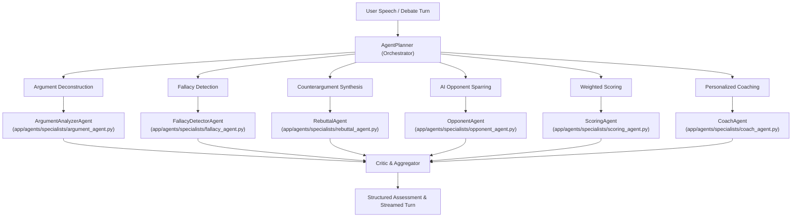

# DebateIQ: Agentic AI Framework & Specialist Design

## 1. Multi-Agent Orchestration Architecture

DebateIQ organizes reasoning into specialized, purpose-built agents managed by an `AgentPlanner`. Each agent handles a single dialectical responsibility, communicates using Pydantic structured output, and operates with retries and a deterministic mock fallback.

## 2. Specialist Agent Roster

### 1. `ArgumentAnalyzerAgent`
- **Goal**: Parse raw speech text into semantic components: main claim, supporting premises, empirical evidence, and counter-claims.
- **Evaluation Criteria**: Clarity, Relevance, Evidence Strength, Logical Consistency, Persuasiveness.
- **Output Schema**: `ArgumentFindingSchema` (`{claim, premises[], evidence[], scores{}, strengths[], weaknesses[], suggestions[]}`).

### 2. `FallacyDetectorAgent`
- **Goal**: Identify instances of the 8 canonical fallacies with exact text spans, confidence ratings, and plain-language explanations.
- **Supported Fallacies**: Ad Hominem, Straw Man, False Dilemma, Slippery Slope, Appeal to Authority, Circular Reasoning, Hasty Generalization, Red Herring.
- **Remediation**: Generates a corrected rewrite demonstrating how to articulate the point without the fallacy.

### 3. `RebuttalAgent`
- **Goal**: Formulate counterarguments across 5 strategic perspectives:
  - *Logical Rebuttal*: Points out inferential gaps or flawed deductions.
  - *Evidence-Based Rebuttal*: Cites counter-data and empirical disparities.
  - *Ethical Rebuttal*: Explores deontological, utilitarian, or rights-based harms.
  - *Practical Rebuttal*: Evaluates logistical, fiscal, and operational feasibility.
  - *Policy Rebuttal*: Proposes counterplans and alternative regulatory frameworks.

### 4. `OpponentAgent`
- **Goal**: Multi-turn debate sparring partner with selectable difficulty and rhetorical style:
  - **Personas**: *Logical Professor* (rigorous, academic, data-driven), *Aggressive Politician* (rhetorical, high-energy, persuasive), *Socratic Questioner* (interrogative, inquiry-driven).
  - **Difficulty Tiers**: *Beginner* (accessible vocabulary, clear arguments), *Intermediate* (nuanced warrants, moderate pacing), *Expert* (ruthless refutation, high-speed cross-examination).
  - **Context-Aware**: Explicitly references the user's prior points and turns.

### 5. `ScoringAgent`
- **Goal**: Applies the strict weighted debate performance scoring model:
  $$\text{Debate Performance Score} = 0.30 \times \text{Argument Quality} + 0.20 \times \text{Evidence Usage} + 0.20 \times \text{Logical Consistency} + 0.15 \times \text{Rebuttal Effectiveness} + 0.15 \times \text{Communication Skills}$$

### 6. `CoachAgent`
- **Goal**: Diagnose skill deficits across historical sessions and produce prescriptive learning plans, exercises, and real-time "coach whisper" tips.

---

## 3. Deterministic Mock Mode vs. Live Gemini Provider
- **Mock Mode**: When `LLM_PROVIDER=mock` or no `GEMINI_API_KEY` is supplied, the framework uses rule-based parsing, discourse grammar trees, and deterministic templates. This allows full offline development and testing.
- **Gemini Mode**: Invokes Gemini models with system instructions, JSON mode, and fallback to mock on error.
