# DebateIQ: Architecture Specification

## 1. High-Level System Architecture

DebateIQ is structured according to Clean Architecture and Service-Oriented Design principles:
- **Presentation Layer**: React 19 + TypeScript + Vite + Tailwind CSS + Framer Motion.
- **API & Gateway Layer**: FastAPI with ASGI, Pydantic v2 schemas, JWT/OAuth2 RBAC guards.
- **Service Layer**: Decoupled business logic (`AuthService`, `SessionService`, `AnalysisService`, `SimulationService`, `ScoringService`, `CoachingService`).
- **Repository Layer**: Encapsulated data access using SQLAlchemy 2.0 ORM patterns.
- **Agentic AI Layer**: Multi-agent orchestration engine (`ArgumentAnalyzerAgent`, `FallacyDetectorAgent`, `RebuttalAgent`, `OpponentAgent`, `ScoringAgent`, `CoachAgent`) with deterministic MOCK mode and Gemini LLM provider.
- **Persistence Layer**: PostgreSQL (primary) with automated SQLite fallback for instant local offline development.

```mermaid
flowchart TD
    subgraph UI ["Frontend (React 19 + Vite + TypeScript)"]
        LandingPage["Landing Page / Showcase"]
        ArenaView["Debate Arena (Live AI Opponent Sparring)"]
        ArgLabView["Argument Lab & X-Ray Mode"]
        RebuttalView["Counterargument Matrix"]
        Dashboards["Role Dashboards (Learner, Coach, Educator, Admin)"]
    end

    subgraph API ["FastAPI Gateway & Routers (/api/v1)"]
        AuthRouter["/auth (JWT, Refresh, Google OAuth2)"]
        UsersRouter["/users & /profiles"]
        DebatesRouter["/debates (Topics, Sessions, Turns)"]
        AnalysisRouter["/analysis (Arguments, Fallacies, Reports)"]
        SimulationRouter["/simulation (AI Opponents, Coach Whisper)"]
        ScoringRouter["/scoring (Weighted 30/20/20/15/15 Engine)"]
        CoachingRouter["/coaching (Learning Paths, Drills)"]
    end

    subgraph CoreServices ["Service Layer"]
        AuthService["AuthService (Bcrypt, JWT)"]
        SessionService["DebateSessionService (6 Formats, Timers)"]
        AnalysisService["ArgumentAnalysisService (Claims, Premises, Evidence)"]
        FallacyService["FallacyDetectionService (8 Canonical Fallacies)"]
        SimulationService["SimulationService (Personas, Challenging)"]
        ScoringService["ScoringService (Weighted Metrics)"]
        CoachingService["CoachingService (Learning Pathways)"]
    end

    subgraph Agents ["Agentic AI Core (/backend/app/agents)"]
        AgentPlanner["Orchestrator & Planner"]
        ArgAgent["ArgumentAnalyzerAgent"]
        FalAgent["FallacyDetectorAgent"]
        RebAgent["RebuttalAgent"]
        OppAgent["OpponentAgent"]
        ScrAgent["ScoringAgent"]
        CchAgent["CoachAgent"]
    end

    subgraph Storage ["Persistence Layer"]
        SQLRepo["SQLAlchemy 2.0 Repositories"]
        DB[("PostgreSQL / SQLite")]
    end

    UI <--> API
    API <--> CoreServices
    CoreServices <--> Agents
    CoreServices <--> SQLRepo
    SQLRepo <--> DB
```

## 2. Authentication & Role-Based Access Control (RBAC)
Four primary personas:
- **`Learner`**: Practices debates, views personal analytics, undergoes AI sparring, tracks XP and skill ratings.
- **`Debate Coach`**: Observes students, creates topics, recalibrates student scores, provides direct feedback.
- **`Educator`**: Class cohort oversight, leaderboard rankings, curriculum debate topic assignments.
- **`Administrator`**: User lifecycle management, platform audit logs, AI model usage analytics.

## 3. Communication Patterns
- Synchronous REST endpoints for deterministic and fast transactional CRUD operations.
- Streaming endpoints (Server-Sent Events / SSE) for real-time AI debate turn streaming and coach whispers.
- Deterministic MOCK mode allowing complete test isolation and zero third-party API dependencies.
