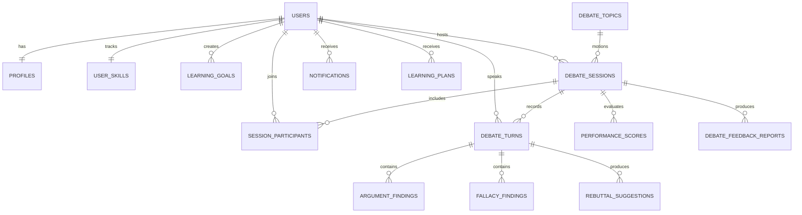

# DebateIQ: Database Schema & Entity Relationships

## 1. Schema Overview

## 2. Table Specifications

### `users`
- `id` (VARCHAR 36, PK): UUID
- `email` (VARCHAR 255, UNIQUE, NOT NULL): User email
- `hashed_password` (VARCHAR 255, NOT NULL): Salted bcrypt hash
- `full_name` (VARCHAR 120, NOT NULL): Display name
- `role` (VARCHAR 32, DEFAULT 'Learner'): One of Learner, Debate Coach, Educator, Administrator
- `avatar_url` (VARCHAR 500, NULLABLE)
- `is_active` (BOOLEAN, DEFAULT TRUE)
- `created_at` (TIMESTAMP)
- `updated_at` (TIMESTAMP)

### `profiles`
- `id` (VARCHAR 36, PK): UUID
- `user_id` (VARCHAR 36, FK -> users.id, UNIQUE): 1:1 with user
- `experience_level` (VARCHAR 32, DEFAULT 'Novice'): Novice, Intermediate, Advanced, Champion
- `preferred_topics` (JSON): e.g. ["AI & Tech", "Ethics", "Economics"]
- `presentation_domains` (JSON): e.g. ["Keynote", "Oxford Debate", "Pitch"]
- `coaching_preferences` (VARCHAR 64, DEFAULT 'Socratic & Balanced')
- `bio` (TEXT)
- `debater_xp` (INTEGER, DEFAULT 0): Gamified progression
- `debater_level` (INTEGER, DEFAULT 1)
- `badges` (JSON): Array of unlocked achievement strings
- `streak_days` (INTEGER, DEFAULT 1)

### `user_skills`
- `id` (VARCHAR 36, PK): UUID
- `user_id` (VARCHAR 36, FK -> users.id, UNIQUE)
- `clarity` (FLOAT, DEFAULT 50.0)
- `reasoning` (FLOAT, DEFAULT 50.0)
- `evidence` (FLOAT, DEFAULT 50.0)
- `rebuttal` (FLOAT, DEFAULT 50.0)
- `delivery` (FLOAT, DEFAULT 50.0)
- `debates_completed` (INTEGER, DEFAULT 0)
- `total_speech_minutes` (INTEGER, DEFAULT 0)

### `learning_goals`
- `id` (VARCHAR 36, PK): UUID
- `user_id` (VARCHAR 36, FK -> users.id)
- `title` (VARCHAR 200, NOT NULL)
- `description` (TEXT)
- `target_skill` (VARCHAR 64): clarity, reasoning, evidence, rebuttal, delivery
- `target_score` (FLOAT, DEFAULT 80.0)
- `current_score` (FLOAT, DEFAULT 50.0)
- `is_completed` (BOOLEAN, DEFAULT FALSE)
- `deadline` (TIMESTAMP, NULLABLE)

### `debate_topics`
- `id` (VARCHAR 36, PK): UUID
- `title` (VARCHAR 200, NOT NULL)
- `motion_text` (TEXT, NOT NULL): "This House Would / Believes..."
- `category` (VARCHAR 64, NOT NULL): Ethics, AI & Technology, Economics, Climate, Law, Healthcare
- `difficulty` (VARCHAR 32, DEFAULT 'Intermediate')
- `proposition_summary` (TEXT)
- `opposition_summary` (TEXT)
- `is_curated` (BOOLEAN, DEFAULT TRUE)
- `created_by` (VARCHAR 36, FK -> users.id, NULLABLE)

### `debate_sessions`
- `id` (VARCHAR 36, PK): UUID
- `topic_id` (VARCHAR 36, FK -> debate_topics.id)
- `debate_format` (VARCHAR 64): One-on-One, Parliamentary, Oxford, Policy, Public Forum, AI Debate Simulation
- `title` (VARCHAR 200, NOT NULL)
- `status` (VARCHAR 32, DEFAULT 'scheduled'): scheduled, live, completed, cancelled
- `scheduled_start` (TIMESTAMP)
- `actual_start` (TIMESTAMP, NULLABLE)
- `actual_end` (TIMESTAMP, NULLABLE)
- `rules_config` (JSON): Timers, speaking turns, POI settings
- `ai_opponent_persona` (VARCHAR 64, DEFAULT 'Logical Professor')
- `ai_difficulty` (VARCHAR 32, DEFAULT 'Intermediate')
- `created_by` (VARCHAR 36, FK -> users.id)

### `session_participants`
- `id` (VARCHAR 36, PK): UUID
- `session_id` (VARCHAR 36, FK -> debate_sessions.id)
- `user_id` (VARCHAR 36, FK -> users.id)
- `position` (VARCHAR 32): proposition, opposition, adjudicator, observer
- `speaking_order` (INTEGER, DEFAULT 1)
- `score_awarded` (FLOAT, NULLABLE)

### `debate_turns`
- `id` (VARCHAR 36, PK): UUID
- `session_id` (VARCHAR 36, FK -> debate_sessions.id)
- `speaker_id` (VARCHAR 36, FK -> users.id, NULLABLE)
- `turn_number` (INTEGER, NOT NULL)
- `speaker_side` (VARCHAR 32): proposition, opposition
- `speaker_type` (VARCHAR 32): human, ai_opponent, moderator
- `transcript_text` (TEXT, NOT NULL)
- `duration_seconds` (FLOAT, DEFAULT 0.0)

### `argument_findings`
- `id` (VARCHAR 36, PK): UUID
- `turn_id` (VARCHAR 36, FK -> debate_turns.id, NULLABLE)
- `claim` (TEXT, NOT NULL)
- `premises` (JSON): Array of strings/objects
- `evidence` (JSON): Array of {type, text, strength, verified}
- `clarity_score` (FLOAT)
- `relevance_score` (FLOAT)
- `evidence_score` (FLOAT)
- `logic_score` (FLOAT)
- `persuasion_score` (FLOAT)
- `overall_score` (FLOAT)
- `strengths` (JSON): Array of strings
- `weaknesses` (JSON): Array of strings
- `suggestions` (JSON): Array of strings

### `fallacy_findings`
- `id` (VARCHAR 36, PK): UUID
- `turn_id` (VARCHAR 36, FK -> debate_turns.id, NULLABLE)
- `fallacy_type` (VARCHAR 64, NOT NULL): Ad Hominem, Straw Man, False Dilemma, etc.
- `excerpt_text` (TEXT, NOT NULL)
- `span_start` (INTEGER, DEFAULT 0)
- `span_end` (INTEGER, DEFAULT 0)
- `confidence` (FLOAT, DEFAULT 0.9)
- `explanation` (TEXT, NOT NULL)
- `corrected_rewrite` (TEXT, NOT NULL)
- `severity` (VARCHAR 32): Low, Medium, High, Critical
- `credibility_penalty` (FLOAT, DEFAULT 15.0)

### `rebuttal_suggestions`
- `id` (VARCHAR 36, PK): UUID
- `turn_id` (VARCHAR 36, FK -> debate_turns.id, NULLABLE)
- `target_argument` (TEXT, NOT NULL)
- `logical_rebuttal` (TEXT, NOT NULL)
- `evidence_rebuttal` (TEXT, NOT NULL)
- `ethical_rebuttal` (TEXT, NOT NULL)
- `practical_rebuttal` (TEXT, NOT NULL)
- `policy_rebuttal` (TEXT, NOT NULL)
- `challenge_questions` (JSON): Array of strings
- `strategic_advice` (TEXT, NOT NULL)

### `performance_scores`
- `id` (VARCHAR 36, PK): UUID
- `session_id` (VARCHAR 36, FK -> debate_sessions.id)
- `user_id` (VARCHAR 36, FK -> users.id)
- `argument_quality` (FLOAT): 30% weight
- `evidence_usage` (FLOAT): 20% weight
- `logical_consistency` (FLOAT): 20% weight
- `rebuttal_effectiveness` (FLOAT): 15% weight
- `communication_skills` (FLOAT): 15% weight
- `weighted_debate_score` (FLOAT): Computed 0-100
- `critical_thinking_score` (FLOAT)
- `overall_performance_score` (FLOAT)

### `debate_feedback_reports`
- `id` (VARCHAR 36, PK): UUID
- `session_id` (VARCHAR 36, FK -> debate_sessions.id)
- `user_id` (VARCHAR 36, FK -> users.id)
- `executive_summary` (TEXT, NOT NULL)
- `rubric_breakdown` (JSON)
- `top_strengths` (JSON)
- `key_vulnerabilities` (JSON)
- `prescribed_drills` (JSON)

### `learning_plans`
- `id` (VARCHAR 36, PK): UUID
- `user_id` (VARCHAR 36, FK -> users.id)
- `title` (VARCHAR 200, NOT NULL)
- `rationale` (TEXT)
- `weekly_modules` (JSON): Array of 4-6 week plan items
- `is_active` (BOOLEAN, DEFAULT TRUE)

### `notifications`
- `id` (VARCHAR 36, PK): UUID
- `user_id` (VARCHAR 36, FK -> users.id)
- `title` (VARCHAR 200, NOT NULL)
- `message` (TEXT, NOT NULL)
- `notification_type` (VARCHAR 64): reminder, feedback_ready, milestone_reached, announcement
- `is_read` (BOOLEAN, DEFAULT FALSE)
