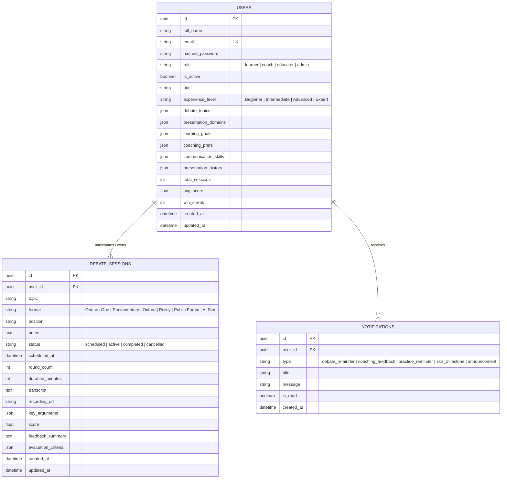

# 🏛️ DebateCoach AI — Full Project Completion Report
## Agentic AI Debate Coach & Presentation Analysis Platform

**Project Title:** Agentic AI Debate Coach & Presentation Analysis Platform  
**Status:** ✅ All 4 Milestones Fully Completed & Verified (27/27 Tests Passing)  
**Stack:** FastAPI (Python 3.13) · React 19 + Vite · SQLite (dev) / PostgreSQL 16 (prod) · Docker  

---

## 📋 Project Overview

The **DebateCoach AI** platform empowers users to cultivate debating, public speaking, critical thinking, and persuasive presentation skills through an agentic AI ecosystem. The platform encompasses:

- **Authentication & RBAC**: JWT-based authentication with 4 distinct roles — Learner, Debate Coach, Educator, and Administrator.
- **User Profiles & Skill Tracking**: Communication skill metrics (clarity, evidence strength, logical consistency, persuasiveness, speaking pace, confidence), debate topics, presentation domains, learning goals, and session histories.
- **Debate Session Management**: End-to-end lifecycle across 6 international debate formats.
- **Argument Mining & Fallacy Detection**: Automated analysis of speech transcripts using an 8-fallacy detection engine.
- **AI Debate Simulation**: Multi-turn sparring against 8 distinct AI opponent personas.
- **Coaching Engine**: Personalized 4-week learning paths and curated drill library.
- **Presentation Analytics**: Speech delivery intelligence (WPM, fillers, confidence, structure).
- **Multi-Format Reporting**: Executive PDF, Excel (.xlsx), and CSV export pipelines.
- **Notification System**: Real-time engagement alerts across 5 functional categories.

---

## 🏗️ System Architecture

### High-Level Architecture

```mermaid
graph TD
    subgraph Client Layer ["Frontend (React 19 + Vite)"]
        UI_Land["Landing & Auth Page"]
        UI_Dash["Role-Adaptive Dashboard<br/>(Learner / Coach / Educator / Admin)"]
        UI_Sess["Debate Session Manager<br/>(Schedule, Run, Evaluate)"]
        UI_Prof["Profile & Skill Tracker<br/>(Radar, Domains, History)"]
    end

    subgraph Gateway ["API Gateway & Core Security"]
        CORS["CORS & Request Validation"]
        JWT_MW["JWT Token Auth & RBAC Guard"]
    end

    subgraph Service Layer ["FastAPI Backend Engine (Python 3.13)"]
        Auth_Svc["Authentication Router (/auth)"]
        User_Svc["User & Skill Router (/users)"]
        Sess_Svc["Session Router (/sessions)"]
        Analysis_Svc["Argument Mining & Fallacy Engine (/analysis)"]
        Sim_Svc["AI Debate Simulation Engine (/simulation)"]
        Coach_Svc["Coaching Engine (/coaching)"]
        Pres_Svc["Presentation Analytics (/presentation)"]
        Report_Svc["Reports & Export (/reports)"]
        Notif_Svc["Notification Engine (/notifications)"]
    end

    subgraph Persistence Layer ["Storage & Database"]
        PG_DB["PostgreSQL 16 (Production/Docker)"]
        SQLITE_DB["SQLite + aiosqlite (Local Dev Fallback)"]
    end

    Client Layer --> CORS --> JWT_MW --> Service Layer --> PG_DB & SQLITE_DB
```

### Database Schema



### Role-Based Access Control (RBAC) Matrix

| Resource & Action | Learner | Debate Coach | Educator | Admin |
|---|:---:|:---:|:---:|:---:|
| **Register & Login** | ✅ | ✅ | ✅ | ✅ |
| **Manage Own Profile & Skill Settings** | ✅ | ✅ | ✅ | ✅ |
| **Create Personal Debate Session** | ✅ | ✅ | ✅ | ✅ |
| **View Personal Debate Sessions** | ✅ | ✅ | ✅ | ✅ |
| **View All Student Debate Sessions** | ❌ | ✅ | ✅ | ✅ |
| **Evaluate & Score Student Sessions** | ❌ | ✅ | ✅ | ✅ |
| **View Class Analytics & Student Roster** | ❌ | ✅ | ✅ | ✅ |
| **Delete Any Session** | ❌ (Own only) | ❌ (Own only) | ❌ (Own only) | ✅ |
| **Broadcast Platform Announcements** | ❌ | ❌ | ❌ | ✅ |
| **System-wide Management** | ❌ | ❌ | ❌ | ✅ |

---

## 📦 Milestone 1 — Project Initialization, Authentication & Session Management
**Week 1 & 2 | Status: ✅ Complete**

### Deliverables

**1. Supported Debate Formats**

| Format | Structure | Target Skills |
|---|---|---|
| **One-on-One Debate** | 2 speakers, alternating speeches & rebuttals | Direct clash, rapid rebuttal |
| **Parliamentary Debate** | Government vs. Opposition, points of information | Spontaneous thinking, rhetoric |
| **Oxford Debate** | Proposition vs. Opposition with audience vote | Audience sway, formal structure |
| **Policy Debate** | Affirmative plan vs. negative counterplan | Research rigor, evidence cards |
| **Public Forum Debate** | Current events topic, crossfire rounds | Civility, crossfire questioning |
| **AI Debate Simulation** | Learner vs. Adaptive AI Agent | Solo practice, logical endurance |

**2. Authentication & Security**
- Production-grade JWT token authentication with bcrypt password hashing.
- OAuth2 SSO endpoint (`/api/v1/auth/oauth2/login`) supporting Google, GitHub, and SAML simulation.
- 4 role profiles: Learner, Debate Coach, Educator, Administrator.
- HTTP 403 enforcement for cross-user resource access attempts.

**3. User Profiles & Skill Tracking**
- Granular communication skill tracking: Clarity, Evidence Strength, Logical Consistency, Rebuttal Skill, Delivery Pace, Confidence.
- Preferred debate topics, presentation domains, learning goals, and coaching preferences.
- Running stats: total sessions, average score, win streak.

**4. Debate Session Management**
- Full CRUD lifecycle: create, schedule, activate, transcript, evaluate, complete, cancel.
- Coach evaluation endpoint with rubric scoring (0–100) and feedback persistence.
- Role-based filtering: Learners see only own sessions; Coaches/Educators see all.

---

## 🧠 Milestone 2 — Argument Analysis & Logical Fallacy Detection Engine
**Week 3 & 4 | Status: ✅ Complete**

### Deliverables

**1. Argument Analysis Engine**
- **Argument Extraction**: Identifies central claims, classifies types (*policy*, *factual*, *value*, *causal*), and extracts premises using structural discourse markers.
- **Evidence Evaluation**: Rates evidence as *weak*, *moderate*, or *strong*.
- **5 Core Evaluation Criteria (0–100 scale):** Clarity, Relevance, Evidence Strength, Logical Consistency, Persuasiveness.

**2. 8-Fallacy Detection Engine**

| # | Fallacy Name | Core Flaw Identified | Remediation Generated |
|---|---|---|---|
| 1 | **Ad Hominem** | Attacks character/motives rather than empirical claims | Refocuses on counter-evidence and data |
| 2 | **Straw Man** | Caricatures opponent's stance into an extreme absurdity | Accurately states opponent's nuanced proposal |
| 3 | **False Dilemma** | Forces an artificial binary dichotomy | Introduces intermediate policy compromises |
| 4 | **Slippery Slope** | Asserts catastrophic chain reaction without warrants | Demands causal mechanisms for every step |
| 5 | **Appeal to Authority** | Relies on celebrity/status instead of domain expertise | Replaces celebrity opinion with peer-reviewed data |
| 6 | **Circular Reasoning** | Conclusion is assumed as its own supporting premise | Provides independent warrants external to conclusion |
| 7 | **Hasty Generalization** | Derives universal absolute claims from single anecdotes | Replaces anecdote with representative cohorts |
| 8 | **Red Herring** | Injects irrelevant emotional topics to derail motion | Restores focus to the active resolution |

**3. Formal Weighted Scoring Model**

```
Debate Performance Score =
  (Argument Quality       × 30%)
+ (Evidence Usage         × 20%)
+ (Logical Consistency    × 20%)
+ (Rebuttal Effectiveness × 15%)
+ (Communication Skills   × 15%)
```

Performance Tiers:
- **88.0 – 100.0:** Elite Master Debater
- **78.0 – 87.9:** Proficient Competitor
- **68.0 – 77.9:** Competent Speaker
- **55.0 – 67.9:** Developing Debater
- **Below 55.0:** Novice Speaker

**4. Argument & Fallacy Lab UI (`/analysis`)**
- Instant Speech Analyzer with preset test cases.
- Fallacy Inspector cards with exact quotes, severity badges, and correction suggestions.
- 5-Criterion Meters and Weighted Score Ribbons.
- Fallacy Reference Modal: searchable educational catalog for all 8 fallacies.

---

## 🤖 Milestone 3 — AI Debate Simulation & Coaching Engine
**Week 5 & 6 | Status: ✅ Complete**

### Deliverables

**1. AI Debate Simulation Engine — 8 AI Opponent Personas**

| Persona | Style | Argumentative Vector |
|---|---|---|
| **Analytical Scholar (Dr. Reeves)** | Empirical, data-driven | Demands peer-reviewed statistics |
| **Aggressive Debater (Jordan Blake)** | Confrontational | Directly attacks premises, exploits logical gaps |
| **Philosopher (Prof. Vann)** | Socratic, conceptual | Challenges axiomatic assumptions |
| **Policy Pragmatist (Alex Chen)** | Solutions-oriented | Cost-benefit analysis, implementation realities |
| **Ethical Advocate (Maya Torres)** | Moral clarity | Deontological vs. utilitarian trade-offs |
| **Devil's Advocate (Sam Reeves)** | Contrarian | Worst-case counterfactuals and fringe scenarios |
| **Socratic Coach (Coach Williams)** | Educational | Guides deeper reasoning via probing questions |
| **Balanced Moderator (Dana Morris)** | Fair, balanced | Steelmans opposing views, identifies common ground |

- Multi-turn sparring lifecycle: opening statements → rebuttals → cross-examination → closing statements.
- Real-time turn coaching: per-turn evaluation and challenge questions.

**2. Counterargument Generation Engine — 5 Required Types**

| Rebuttal Type | Analytical Focus | Core Argumentative Vector |
|---|---|---|
| **Logical Rebuttal** | Syllogistic Validity | Identifies bridging gaps and unproven inferences |
| **Evidence-Based Rebuttal** | Empirical Rigor | Points out unrepresentative sample sizes, biases |
| **Ethical Counterargument** | Moral Philosophy | Analyzes disparate stakeholder impacts |
| **Practical Counterargument** | Execution Feasibility | Highlights opportunity costs, bottlenecks |
| **Policy Counterargument** | Comparative Policy | Evaluates regulatory models, unintended distortions |

Each counterargument includes: Direct Rebuttal Passage, Targeted Challenge Question, Debate Strategy Recommendation.

**3. Personalized Coaching & Learning Plan Engine**
- Diagnoses primary bottlenecks across all 5 rubric dimensions.
- Quantifies skill gaps against the **80-point competitive benchmark**.
- Generates structured **4-Week Learning Paths** with week-by-week goals, themes, and daily practice commitments.
- **Curated Drill Library**: 10+ debate drills (1-Minute Impromptu, Rebuttal Blitz, Toulmin Mapping, Steelmanning Practice, Impact Calculus, etc.).

---

## 🎤 Milestone 4 — Presentation Analytics, Testing & Deployment
**Week 7 & 8 | Status: ✅ Complete**

### Deliverables

**1. Presentation & Speech Analysis Engine**
- **Speaking Pace (WPM):** Categorizes delivery — *Too Slow (<110)*, *Measured (110–130)*, *Optimal (130–160)*, *Rapid (>170 WPM)*.
- **Filler Word Mining**: Detects 20+ filler expressions, calculates absolute counts and filler rate percentage.
- **Confidence Score Estimation**: Power words vs. hedging language ratio analysis.
- **Clarity & Engagement Scoring**: Rhetorical questions, audience engagement phrases, sentence length cadence.
- **Structure Checklist**: Hook/opener, transitional signposts, conclusion.
- **Audio Upload Endpoint**: `POST /api/v1/presentation/upload-audio` accepts `.wav`, `.mp3`, `.m4a`, `.webm`.
- **Persistent Presentation History**: Tracks progression across all evaluated speeches.

**2. Notification & Engagement System — 5 Categories**
1. **Debate Reminders** — upcoming scheduled debate round alerts.
2. **Coaching Feedback Alerts** — notifies when coach has evaluated a session.
3. **Practice Session Reminders** — prompts for daily 2-minute drills.
4. **Skill Milestone Notifications** — celebrates benchmark achievements.
5. **Platform Announcements** — broadcasts to all registered users.

Features: real-time unread badges in navigation bar, dropdown notification center, mark-as-read endpoints.

**3. Reports & Multi-Format Export System**

| Endpoint | Report Type |
|---|---|
| `GET /api/v1/reports/performance` | Aggregated scores, trends, rubric averages |
| `GET /api/v1/reports/debate` | Format distributions, win streaks |
| `GET /api/v1/reports/presentation` | WPM velocity, filler word rates, delivery trends |
| `GET /api/v1/reports/coaching` | Priority growth areas, benchmark gaps, recommended drills |
| `GET /api/v1/reports/learning-progress` | Weekly target completion, milestone achievements |
| `GET /api/v1/reports/export/pdf` | Executive PDF report (ReportLab) |
| `GET /api/v1/reports/export/excel` | Multi-sheet .xlsx workbook (openpyxl) |
| `GET /api/v1/reports/export/csv` | Tabular CSV sessions export |

**4. Role-Adaptive Dashboards**
- **Learner Dashboard**: Win streaks, performance trends, communication radar, recent sessions.
- **Coach Dashboard**: Student roster, pending evaluations, average student scores.
- **Educator Dashboard**: Class analytics, student rankings, session performance reports.
- **Admin Dashboard**: Platform-wide analytics, user role distributions, platform benchmarks.

**5. Containerization & Production Deployment**
- **Docker Compose** (`docker-compose.yml`): PostgreSQL 16 + FastAPI (Uvicorn) + React/Nginx containers.
- **Local Fallback**: Automatic zero-config fallback to `sqlite+aiosqlite` when PostgreSQL is absent.

---

## ✅ Comprehensive Automated Test Results

All 4 Milestones: **27/27 tests passing (100%)**

```
backend$ pytest -v
============================= test session starts =============================
platform win32 -- Python 3.13.4, pytest-9.1.1
collected 27 items

tests/test_milestone1.py::TestMilestone1::test_01_health_check                          PASSED [  3%]
tests/test_milestone1.py::TestMilestone1::test_02_registration_all_roles                PASSED [  7%]
tests/test_milestone1.py::TestMilestone1::test_03_login_and_auth_validation             PASSED [ 11%]
tests/test_milestone1.py::TestMilestone1::test_04_user_profile_and_skill_tracking       PASSED [ 14%]
tests/test_milestone1.py::TestMilestone1::test_05_debate_session_lifecycle              PASSED [ 18%]
tests/test_milestone1.py::TestMilestone1::test_06_role_based_access_and_evaluation      PASSED [ 22%]
tests/test_milestone2.py::TestMilestone2::test_01_supported_fallacies_catalog           PASSED [ 25%]
tests/test_milestone2.py::TestMilestone2::test_02_detect_ad_hominem_and_slippery_slope  PASSED [ 29%]
tests/test_milestone2.py::TestMilestone2::test_03_detect_false_dilemma_and_straw_man    PASSED [ 33%]
tests/test_milestone2.py::TestMilestone2::test_04_detect_circular_reasoning_and_appeal_to_authority PASSED [ 37%]
tests/test_milestone2.py::TestMilestone2::test_05_detect_hasty_gen_and_red_herring      PASSED [ 40%]
tests/test_milestone2.py::TestMilestone2::test_06_sound_argument_evaluation_and_weighted_scoring    PASSED [ 44%]
tests/test_milestone2.py::TestMilestone2::test_07_session_transcript_analysis_integration           PASSED [ 48%]
tests/test_milestone3.py::TestMilestone3::test_01_simulation_personas_catalog           PASSED [ 51%]
tests/test_milestone3.py::TestMilestone3::test_02_simulation_start_and_turn_progression PASSED [ 55%]
tests/test_milestone3.py::TestMilestone3::test_03_counterargument_generation_all_types  PASSED [ 59%]
tests/test_milestone3.py::TestMilestone3::test_04_coaching_recommendations              PASSED [ 62%]
tests/test_milestone3.py::TestMilestone3::test_05_personalized_learning_plan            PASSED [ 66%]
tests/test_milestone3.py::TestMilestone3::test_06_skill_gap_analysis                    PASSED [ 70%]
tests/test_milestone3.py::TestMilestone3::test_07_drill_library                         PASSED [ 74%]
tests/test_milestone4.py::TestMilestone4::test_01_presentation_analysis_and_history     PASSED [ 77%]
tests/test_milestone4.py::TestMilestone4::test_02_audio_presentation_upload             PASSED [ 81%]
tests/test_milestone4.py::TestMilestone4::test_03_reports_endpoints                     PASSED [ 85%]
tests/test_milestone4.py::TestMilestone4::test_04_export_system_csv_excel_pdf           PASSED [ 88%]
tests/test_milestone4.py::TestMilestone4::test_05_admin_overview_rbac                   PASSED [ 92%]
tests/test_milestone4.py::TestMilestone4::test_06_notifications_and_engagement_system   PASSED [ 96%]
tests/test_milestone4.py::TestMilestone4::test_07_oauth2_sso_login                      PASSED [100%]

======================= 27 passed, 47 warnings in 8.66s =======================
```

---

## 📁 Complete File Inventory

| Layer | File | Milestone | Purpose |
|---|---|:---:|---|
| **Backend Core** | `backend/main.py` | All | FastAPI app lifecycle, CORS, router aggregation |
| **Backend Service** | `backend/app/services/argument_analysis.py` | 2 | 8-Fallacy detector, premise extractor, 30/20/20/15/15 scoring |
| **Backend Service** | `backend/app/services/debate_simulation.py` | 3 | 8-Persona AI sparring engine, multi-turn lifecycle |
| **Backend Service** | `backend/app/services/coaching.py` | 3 | Personalized recommendations, 4-week plans, drill library |
| **Backend Service** | `backend/app/services/presentation_analysis.py` | 4 | WPM, filler words, confidence, structure analysis |
| **Backend Router** | `backend/app/routers/auth.py` | 1 | JWT auth, registration, OAuth2 SSO |
| **Backend Router** | `backend/app/routers/users.py` | 1 | Profile management, skill tracking, student roster |
| **Backend Router** | `backend/app/routers/sessions.py` | 1 | Debate session CRUD & coach evaluation |
| **Backend Router** | `backend/app/routers/analysis.py` | 2 | Argument evaluation, fallacy catalog, session analysis |
| **Backend Router** | `backend/app/routers/simulation.py` | 3 | Persona catalog, debate arena, counterarguments |
| **Backend Router** | `backend/app/routers/coaching.py` | 3 | Recommendations, learning plans, skill gap, drills |
| **Backend Router** | `backend/app/routers/presentation.py` | 4 | Speech analysis, audio upload, history, tips |
| **Backend Router** | `backend/app/routers/reports.py` | 4 | 5 report types + PDF/Excel/CSV export |
| **Backend Router** | `backend/app/routers/notifications.py` | 4 | Engagement system, unread badges, mark-as-read |
| **Backend Models** | `backend/app/models/user.py` | 1 | SQLAlchemy User ORM model |
| **Backend Models** | `backend/app/models/debate_session.py` | 1 | SQLAlchemy DebateSession ORM model |
| **Backend Models** | `backend/app/models/notification.py` | 4 | SQLAlchemy Notification ORM model |
| **Backend Tests** | `backend/tests/test_milestone1.py` | 1 | 6 automated tests — Auth, Profile, RBAC, Sessions |
| **Backend Tests** | `backend/tests/test_milestone2.py` | 2 | 7 automated tests — 8 fallacies, scoring, session integration |
| **Backend Tests** | `backend/tests/test_milestone3.py` | 3 | 7 automated tests — AI simulation, counterarguments, coaching |
| **Backend Tests** | `backend/tests/test_milestone4.py` | 4 | 7 automated tests — Presentation, reports, exports, notifications |
| **Frontend Page** | `frontend/src/pages/Landing.jsx` | 1 | Platform landing page |
| **Frontend Page** | `frontend/src/pages/Login.jsx` | 1 | Authentication & OAuth2 SSO login |
| **Frontend Page** | `frontend/src/pages/Signup.jsx` | 1 | User registration flow |
| **Frontend Page** | `frontend/src/pages/Dashboard.jsx` | 1+4 | 4-Tier Role-Adaptive Dashboard |
| **Frontend Page** | `frontend/src/pages/DebateSessions.jsx` | 1+2 | Session Manager with inline AI evaluator |
| **Frontend Page** | `frontend/src/pages/Profile.jsx` | 1 | User skill tracker & radar chart |
| **Frontend Page** | `frontend/src/pages/ArgumentAnalysis.jsx` | 2 | Interactive Argument & Fallacy Lab |
| **Frontend Page** | `frontend/src/pages/DebateSimulation.jsx` | 3 | 8-Persona AI Sparring Arena |
| **Frontend Page** | `frontend/src/pages/Coaching.jsx` | 3 | 4-Week Study Plans & Drill Library |
| **Frontend Page** | `frontend/src/pages/PresentationAnalysis.jsx` | 4 | Speech & Audio Intelligence |
| **Frontend Page** | `frontend/src/pages/Reports.jsx` | 4 | PDF, Excel & CSV Export System |
| **Frontend Component** | `frontend/src/components/Navbar.jsx` | 1+4 | Navbar with notification badge |
| **Frontend Component** | `frontend/src/components/Sidebar.jsx` | All | Application sidebar navigation |
| **Deployment** | `docker-compose.yml` | 4 | PostgreSQL + FastAPI + Nginx orchestration |
| **Deployment** | `backend/Dockerfile` | 4 | FastAPI backend container |
| **Deployment** | `frontend/Dockerfile` | 4 | React + Nginx frontend container |
| **Config** | `backend/.env.example` | All | Environment variable template |
| **Config** | `backend/requirements.txt` | All | Python dependency manifest |
| **Documentation** | `README.md` | All | Project overview, quick start, API reference |
| **Documentation** | `docs/PROJECT_COMPLETION_REPORT.md` | All | This unified completion report |
