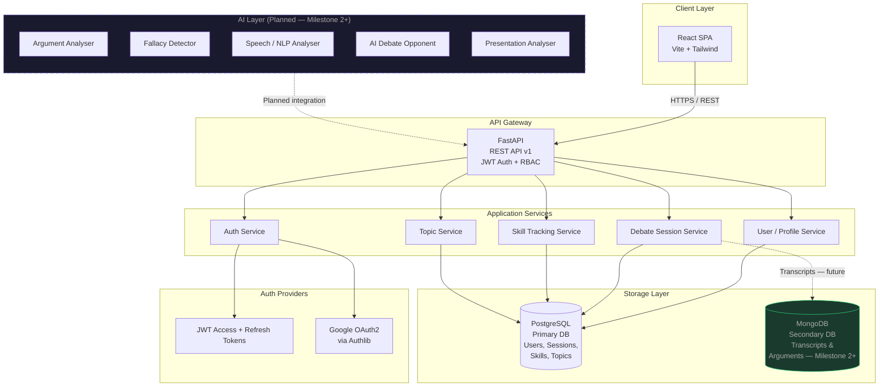
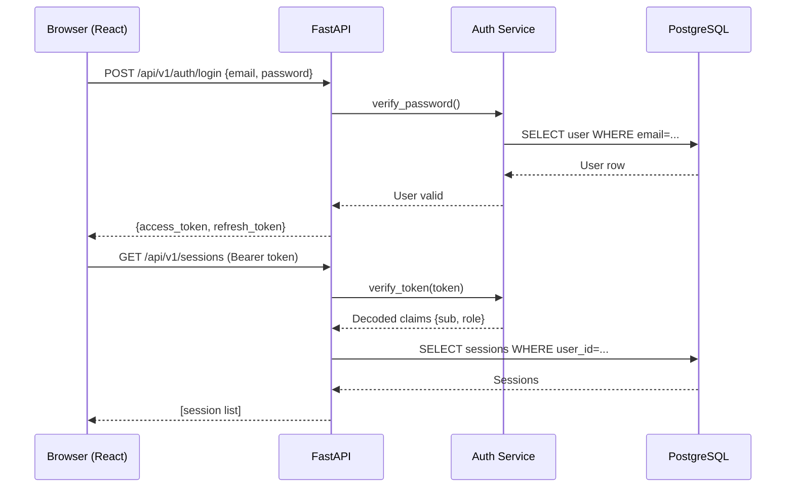
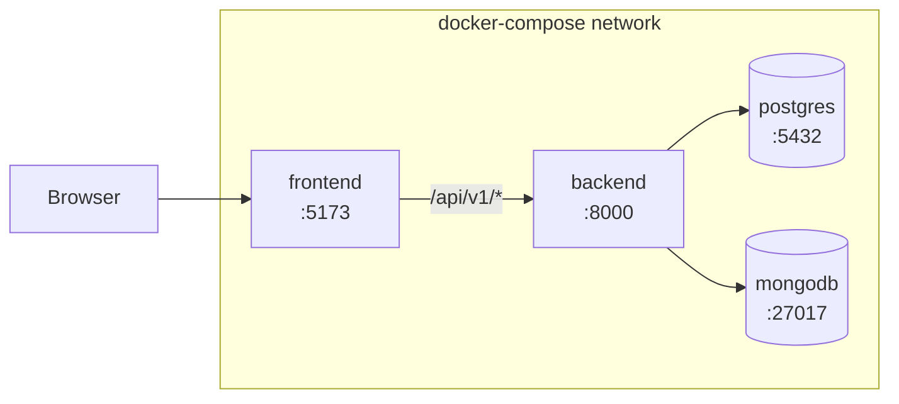

# System Architecture — Agentic AI Debate Coach & Presentation Analysis Platform

## Overview

The platform is a multi-tier web application that guides learners through structured debate practice, skill tracking, and (in future milestones) AI-powered coaching and presentation analysis.

---

## High-Level Architecture

---

## Component Descriptions

| Component | Technology | Responsibility |
|-----------|-----------|---------------|
| React SPA | Vite + React 18 + Tailwind CSS | UI rendering, routing, auth state |
| FastAPI Gateway | Python 3.11 + FastAPI | REST API, request validation, CORS |
| Auth Service | Authlib + python-jose + passlib | JWT issuance, Google OAuth, RBAC |
| User/Profile Service | SQLAlchemy 2.0 async | User CRUD, profiles, learning goals |
| Debate Session Service | SQLAlchemy 2.0 async | Topics, sessions, participants |
| Skill Tracking Service | SQLAlchemy 2.0 async | Skill records, summaries, trends |
| PostgreSQL | PostgreSQL 15 | Primary relational store |
| MongoDB | MongoDB 7 | Future: transcripts, argument graphs |
| AI Layer | Planned (Milestone 2+) | NLP, argument analysis, coaching |

---

## Request Flow

---

## Deployment Architecture (Docker Compose)

---

## Security Model

- **Access Token**: HS256 JWT, 15-minute TTL, contains `sub` (user_id) and `role`.
- **Refresh Token**: HS256 JWT, 7-day TTL, stored in httpOnly cookie.
- **Password Hashing**: bcrypt with 12 rounds via `passlib`.
- **Google OAuth**: PKCE flow via Authlib; user created/linked on first login.
- **RBAC**: `require_roles(*roles)` FastAPI dependency; four roles: `learner`, `debate_coach`, `educator`, `administrator`.
- **CORS**: Allow list configured via `ALLOWED_ORIGINS` env var.

---

## Future AI Integration Points

The following hooks are reserved in the codebase (as TODOs and stub modules) for Milestone 2+:

| Hook | Location | AI Feature |
|------|----------|-----------|
| `POST /sessions/{id}/analyse` | `api/v1/sessions.py` | Argument analysis + fallacy detection |
| `POST /sessions/{id}/speech` | `api/v1/sessions.py` | Speech NLP analysis |
| `POST /sessions/{id}/ai-opponent` | `api/v1/sessions.py` | AI debate opponent |
| `POST /presentations/{id}/analyse` | `api/v1/profiles.py` | Presentation analysis |
| `services/mongodb.py` | Motor async client | Transcript + argument graph storage |
