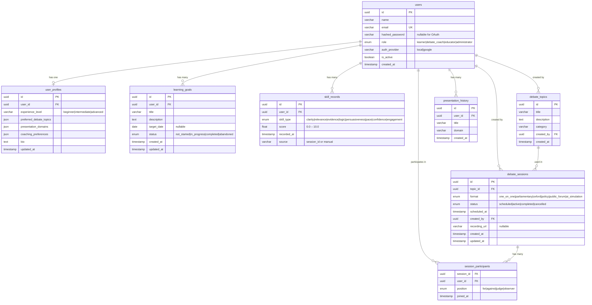

# Database Schema — Agentic AI Debate Coach & Presentation Analysis Platform

## Entity-Relationship Diagram

---

## Table Descriptions

### `users`
Core identity table. Supports both local (email+password) and OAuth (Google) accounts.

| Column | Type | Notes |
|--------|------|-------|
| `id` | UUID | Primary key, auto-generated |
| `name` | VARCHAR(255) | Full display name |
| `email` | VARCHAR(255) | Unique, indexed |
| `hashed_password` | VARCHAR(255) | Nullable — null for OAuth-only users |
| `role` | ENUM | `learner`, `debate_coach`, `educator`, `administrator` |
| `auth_provider` | VARCHAR(50) | `local` or `google` |
| `is_active` | BOOLEAN | Soft disable without deletion |
| `created_at` | TIMESTAMPTZ | Auto-set on insert |

---

### `user_profiles`
Extended profile data. One-to-one with `users`. Created lazily on first profile update.

| Column | Type | Notes |
|--------|------|-------|
| `id` | UUID | Primary key |
| `user_id` | UUID FK | References `users.id`, unique |
| `experience_level` | VARCHAR | `beginner`, `intermediate`, `advanced` |
| `preferred_debate_topics` | JSONB | List of topic category strings |
| `presentation_domains` | JSONB | e.g. `["tech", "policy"]` |
| `coaching_preferences` | JSONB | e.g. `{"style": "Socratic"}` |
| `bio` | TEXT | Free-text biography |
| `updated_at` | TIMESTAMPTZ | Auto-updated |

---

### `learning_goals`
Self-set learning objectives per user.

| Column | Type | Notes |
|--------|------|-------|
| `id` | UUID | Primary key |
| `user_id` | UUID FK | References `users.id` |
| `title` | VARCHAR(255) | Short goal label |
| `description` | TEXT | Optional detail |
| `target_date` | DATE | Nullable deadline |
| `status` | ENUM | `not_started`, `in_progress`, `completed`, `abandoned` |
| `created_at` / `updated_at` | TIMESTAMPTZ | Timestamps |

---

### `skill_records`
Time-series skill scores per user. Each entry is one measurement event.

| Column | Type | Notes |
|--------|------|-------|
| `id` | UUID | Primary key |
| `user_id` | UUID FK | References `users.id` |
| `skill_type` | ENUM | 8 skill types (see below) |
| `score` | FLOAT | 0.0 – 10.0 |
| `recorded_at` | TIMESTAMPTZ | When the score was captured |
| `source` | VARCHAR | Session ID or `"manual"` |

**Skill types**: `clarity`, `relevance`, `evidence`, `logic`, `persuasiveness`, `pace`, `confidence`, `engagement`

---

### `debate_topics`
A library of debate propositions that sessions can reference.

| Column | Type | Notes |
|--------|------|-------|
| `id` | UUID | Primary key |
| `title` | VARCHAR(255) | Topic statement |
| `description` | TEXT | Context / background |
| `category` | VARCHAR(100) | e.g. `Politics`, `Technology`, `Ethics` |
| `created_by` | UUID FK | References `users.id` |
| `created_at` | TIMESTAMPTZ | Auto-set on insert |

---

### `debate_sessions`
A scheduled or completed debate event.

| Column | Type | Notes |
|--------|------|-------|
| `id` | UUID | Primary key |
| `topic_id` | UUID FK | References `debate_topics.id` |
| `format` | ENUM | 6 formats (see below) |
| `status` | ENUM | `scheduled`, `active`, `completed`, `cancelled` |
| `scheduled_at` | TIMESTAMPTZ | When the session is planned |
| `created_by` | UUID FK | References `users.id` |
| `recording_url` | VARCHAR | Nullable — populated post-session (Milestone 2+) |
| `created_at` / `updated_at` | TIMESTAMPTZ | Timestamps |

**Formats**: `one_on_one`, `parliamentary`, `oxford`, `policy`, `public_forum`, `ai_simulation`

---

### `session_participants`
Join table linking users to sessions with their assigned position.

| Column | Type | Notes |
|--------|------|-------|
| `session_id` | UUID FK | References `debate_sessions.id` |
| `user_id` | UUID FK | References `users.id` |
| `position` | ENUM | `for`, `against`, `judge`, `observer` |
| `joined_at` | TIMESTAMPTZ | Auto-set on insert |

Composite PK: `(session_id, user_id)`

---

### `presentation_history`
Lightweight log of presentation events. Full analysis stored in MongoDB (Milestone 2+).

| Column | Type | Notes |
|--------|------|-------|
| `id` | UUID | Primary key |
| `user_id` | UUID FK | References `users.id` |
| `title` | VARCHAR(255) | Presentation title |
| `domain` | VARCHAR(100) | Subject area |
| `created_at` | TIMESTAMPTZ | Auto-set on insert |

---

## Indexes

| Table | Index | Reason |
|-------|-------|--------|
| `users` | `email` (unique) | Login lookup |
| `skill_records` | `(user_id, skill_type, recorded_at)` | Summary queries |
| `debate_sessions` | `(status, scheduled_at)` | Filter + sort |
| `session_participants` | `(session_id)`, `(user_id)` | Join queries |
