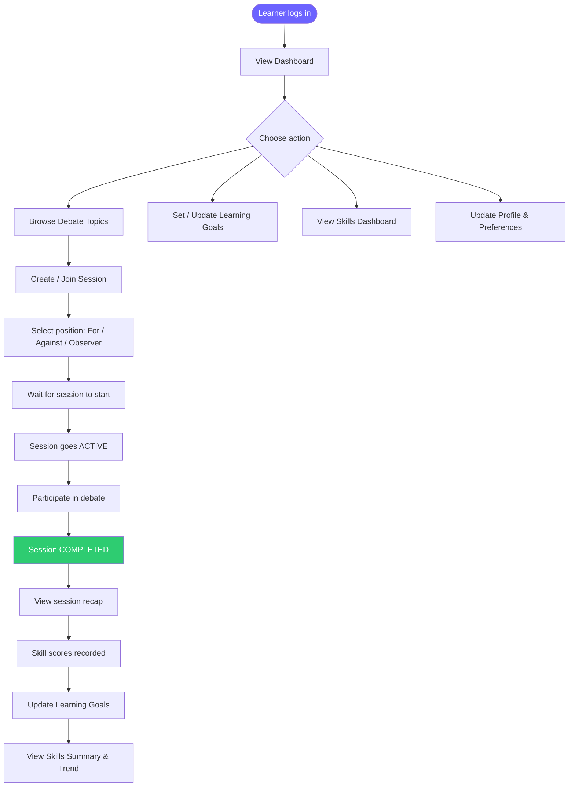
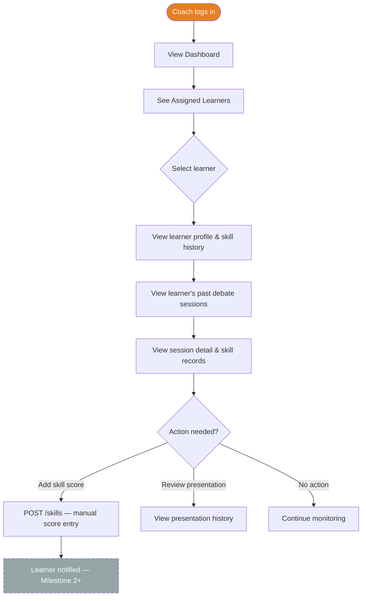
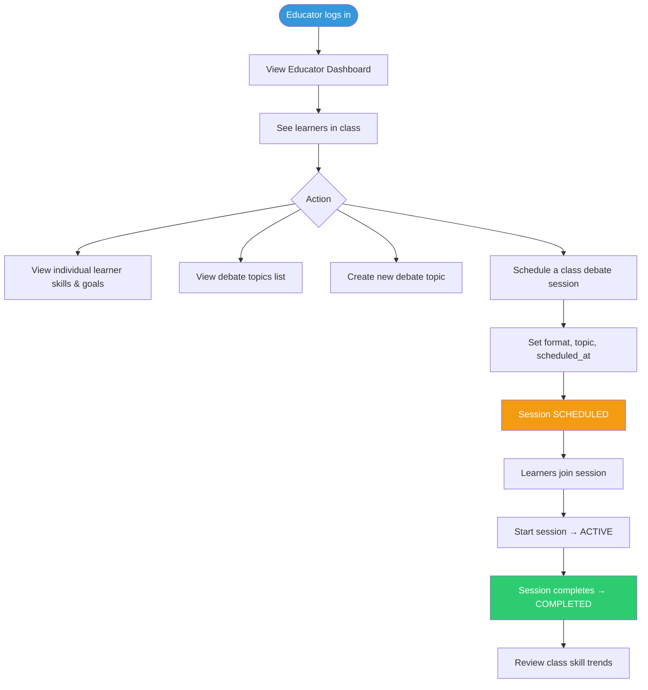
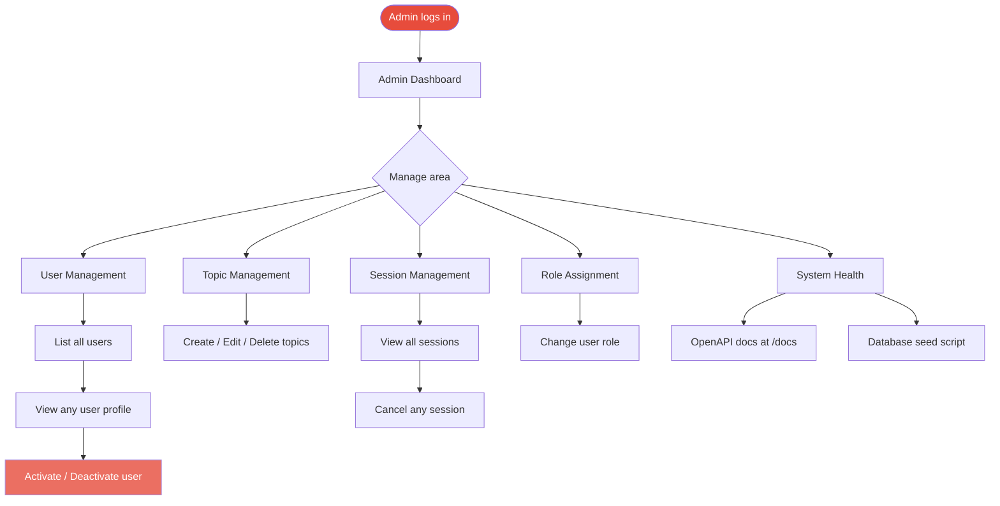
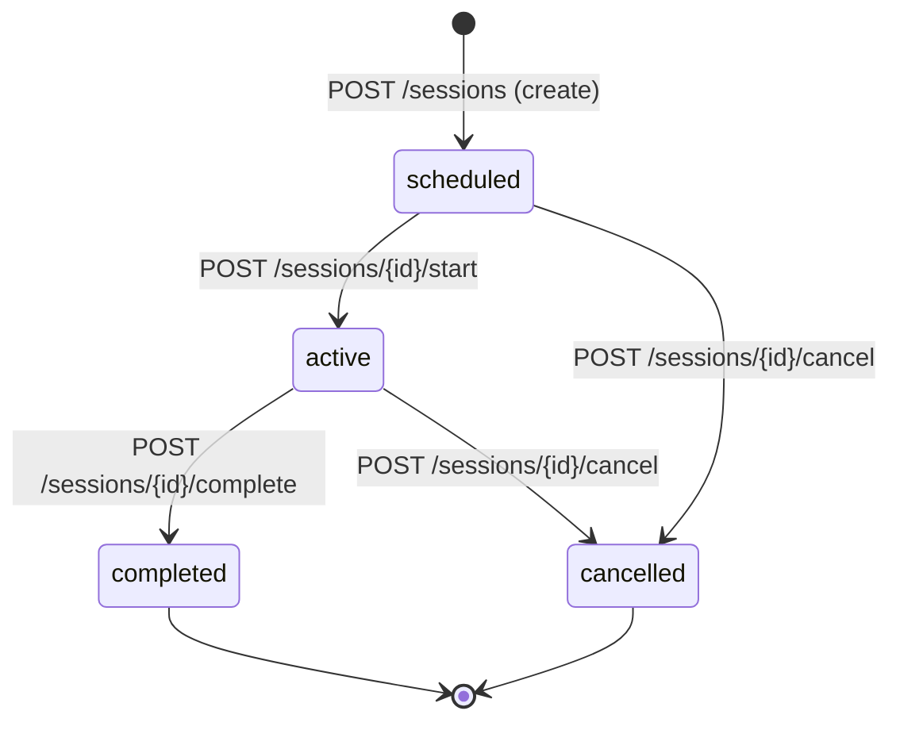
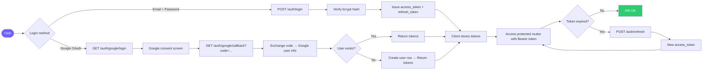

# Workflows — Agentic AI Debate Coach & Presentation Analysis Platform

## 1. Learner Practice Workflow

### Key Rules
- Learners can only view/manage their **own** data.
- A learner may join a session as `for`, `against`, or `observer`.
- Skill records are auto-created when a session is completed (manual entry also allowed).
- Learning goals are user-managed; status changes are manual in Milestone 1, automated in Milestone 2+.

---

## 2. Debate Coach Review Workflow

### Key Rules
- Coaches can view **assigned learners'** session history and skill records.
- Coaches can add manual skill scores on behalf of a learner (source = `"manual"`).
- Coaches **cannot** modify user accounts or create new topics.

---

## 3. Educator Class Monitoring Workflow

### Key Rules
- Educators can view **all learners** (their class scope enforced in Milestone 2+; currently all learners in Milestone 1).
- Educators can create topics and schedule sessions.
- Educators can start/complete sessions they created.

---

## 4. Administrator Management Workflow

### Key Rules
- Administrators have **full access** to all resources.
- Only administrators can change user roles or deactivate accounts.
- Seed script (`python -m app.seed`) creates initial admin + sample data.

---

## 5. Session Lifecycle State Machine

---

## 6. Authentication Flow

